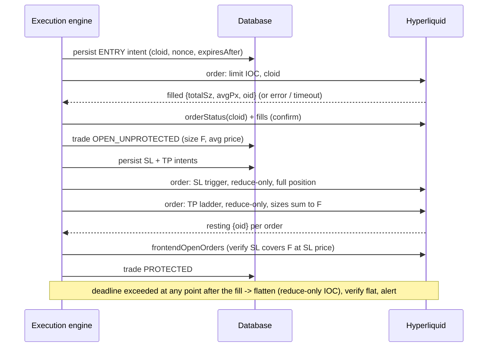
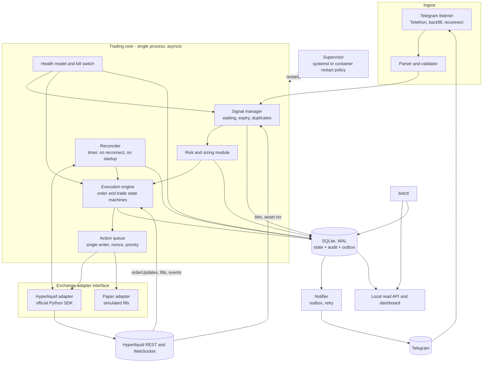
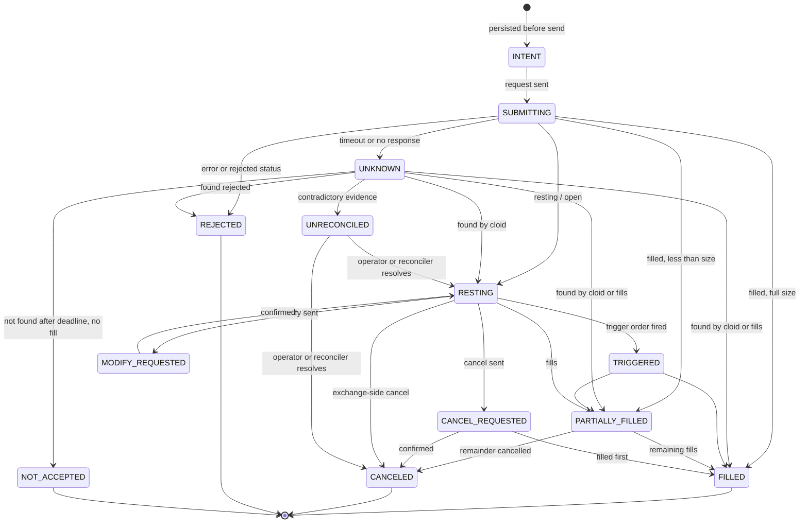
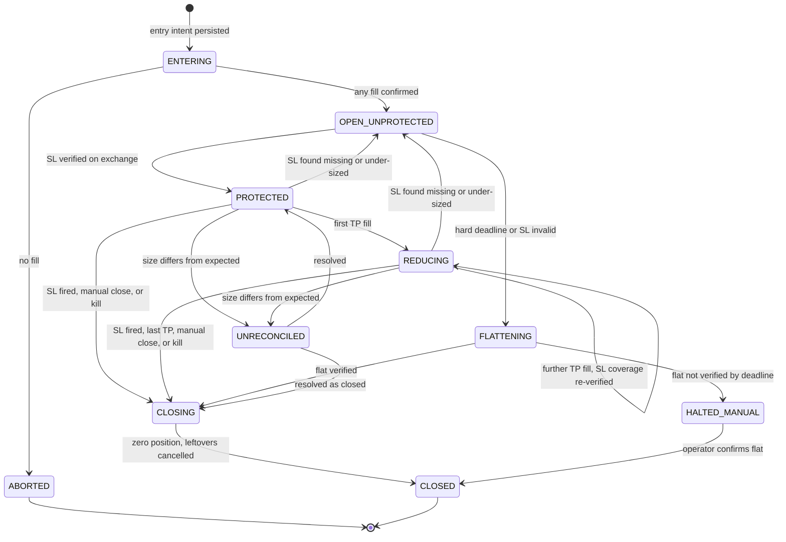

# PRD — Rebuilding the Telegram Signal Trading Bot on Hyperliquid

| | |
|---|---|
| **Document status** | Draft v1.0 for owner review |
| **Date** | 2026-10-10 |
| **Baseline analysed** | Repository `telegram-scraper`, branch `main`, commit `998844e` ("enhance", 2026-10-10) |
| **Existing execution venue** | MetaTrader 5 (broker terminal, Windows) |
| **Target execution venue** | Hyperliquid perpetuals (HyperCore API) |
| **Hyperliquid facts verified on** | 2026-10-10, against official docs and the public read-only `info` API (no account, no orders) |

**How to read the evidence labels used throughout**

| Label | Meaning |
|---|---|
| **VERIFIED** | Read directly in source code, config templates, tests, or committed logs at the baseline commit; or confirmed in official Hyperliquid docs / the public `info` API on the date above. |
| **INFERRED** | Reasonable conclusion that is not directly proven by the evidence. Needs confirmation before it is relied on. |
| **MISSING** | Does not exist in the current application; must be built. |
| **IV-nn** | "Integration verification" item: a Hyperliquid behaviour the design depends on that official docs do not fully specify. Must be proven on testnet before the dependent requirement is accepted (list in §9.7). |

No private keys, passwords, API hashes, bot tokens, chat IDs, or channel identifiers are reproduced in this document.

---

## 1. Executive summary

The existing application is a single-operator, command-line Python bot that listens to Telegram trading-signal channels, parses gold (`#GOLD`) signals of the form *"SELL, zone 4286–4289, SL 4296, TP1…TP5"*, and — when the live price is inside the signal zone plus a buffer — opens **one MT5 market order per take-profit level**, each carrying the signal's stop-loss and its own take-profit. It reports signal, fill, and close outcomes to the operator over a Telegram bot. It is file-based (JSON/JSONL), polled, Windows-bound for live trading, and has no database, no web UI, and no order/position reconciliation.

This PRD specifies a rebuild that keeps what works (Telegram ingestion, the parser/validator, the zone-plus-buffer market-entry rule, the TP ladder, expiry, duplicate protection, risk-based sizing, dry-run-by-default, Telegram notifications) and replaces the execution layer with Hyperliquid.

Three facts drive most of the design:

1. **Hyperliquid has one net position per asset per account — there is no hedging mode.** The current "one position per TP level" structure cannot be reproduced. The rebuild uses **one entry order, one stop-loss covering the whole position, and N reduce-only take-profit orders** (§10.4).
2. **Protection is not atomic on Hyperliquid the way it is on MT5.** MT5 accepts SL/TP inside the entry request. On Hyperliquid, parent-linked TP/SL children are only placed if the parent *fully* fills; a partially filled, then cancelled parent leaves the fill unprotected (official docs, §9.3). The rebuild therefore treats "position open" and "position protected" as separate, verified states, with a hard deadline after which an unprotected position is flattened (§10.5).
3. **The traded instrument changes.** All 12 signals in the recorded data are `GOLD`. Hyperliquid's gold exposure is either `xyz:GOLD` (a HIP-3 builder-deployed perp) or `PAXG` (a perp on tokenised gold). Both were live on 2026-10-10, and their mark prices differed by about 3 price points at the same instant — larger than the bot's default ±2-point entry buffer. Signal price levels written against a broker's XAUUSD feed will not line up exactly with either market. This is the largest open product decision (OQ-01, OQ-02).

The rebuild prioritises capital protection over features: every order has a persisted intent before it is sent, every exchange response is reconciled against actual exchange state, unknown outcomes are resolved before anything is retried, and trading pauses automatically whenever account or market state cannot be verified.

**Preliminary where noted.** The live MT5 path was run by the operator (committed logs show an `--auto --live` session), but the repository contains **no recorded live fill** — all 12 stored execution records are dry runs from an older executor version. Behaviour of the live MT5 path is therefore verified from code and from tests against a fake MT5, not from production records.

---

## 2. Product vision and objectives

**Vision.** A signal-following execution service the operator can leave running unattended: it never enters a trade it cannot size, never holds a position it cannot prove is protected, and never leaves the operator guessing about what the exchange actually did.

| ID | Objective | Measure of success |
|---|---|---|
| OBJ-1 | Execute the existing signal strategy on Hyperliquid | Signals that pass validation and risk checks result in a Hyperliquid position with verified SL and TP ladder, or a recorded reason why not |
| OBJ-2 | Never hold an unprotected position beyond a bounded window | 100% of fills reach `PROTECTED` or are flattened within the hard deadline (NFR-004) |
| OBJ-3 | Never send a duplicate order | 0 duplicate entries across the crash-injection suite (TC-070..TC-075) |
| OBJ-4 | Local state always converges to exchange state | Divergence detected within 30 s and resolved or escalated (NFR-006) |
| OBJ-5 | Preserve operator experience | Same CLI verbs and the same five notification types, plus critical alerts |
| OBJ-6 | Remove the Windows/MT5 terminal dependency | Runs headless on Linux under a supervisor |
| OBJ-7 | Make every trade auditable end-to-end | Any fill can be traced to its order, risk assessment, signal, and source Telegram message |

---

## 3. Problem statement

1. **Venue mismatch.** The operator wants to execute on Hyperliquid. The current executor is hard-wired to the `MetaTrader5` Python package (Windows-only, requires a running logged-in terminal) and to MT5 concepts that do not exist on Hyperliquid: lots, magic numbers, hedged tickets, per-position SL/TP fields, `deviation`, broker "points".
2. **No reconciliation.** The current bot records what it *asked for* and reads back SL/TP once after the fill. It never re-checks open orders or positions afterwards, and a send whose outcome is unknown (`order_send()` returned `None`) is recorded as `error` and never resolved.
3. **Polled, not event-driven.** A signal waiting for price to enter its zone is re-checked only when a new Telegram message arrives or every 30 s. A price that touches the zone between polls is missed.
4. **Fragile runtime.** Committed logs show the live process exiting after Telegram reconnection failed five times during a network outage. Nothing restarts it. The "stopped" notification could not be delivered for the same reason.
5. **Risk controls are opt-in.** Every `RISK_*` limit is off unless set. Fixed lot size is the default. There is no kill switch, no exposure or leverage cap, no risk-to-reward check.
6. **Weak state model.** Seven JSON state files keyed by Telegram `message_id` alone. With multi-channel support (added in the baseline commit), message IDs from different channels can collide, and a colliding message is silently dropped as a "duplicate".

---

## 4. Scope

### 4.1 In scope (v1)

- Telegram ingestion from one or more channels (existing behaviour, hardened).
- Signal parsing, validation, and planning (existing logic, ported).
- Hyperliquid account, market-data, and order integration for **USDC-collateralised perpetuals**, one configured account.
- Entry by marketable IOC limit order when price is inside the buffered signal zone.
- One stop-loss covering the full position plus a TP ladder of reduce-only orders.
- Verification of every order and of protective coverage against exchange state.
- Backend-enforced risk controls and a persistent kill switch.
- Continuous reconciliation, startup recovery, and unknown-outcome resolution.
- Relational persistence with an append-only audit log.
- Telegram notifications (existing five kinds) plus critical alerts.
- CLI control tool with parity to the existing `bot.bat` / `bot.sh` verbs.
- Three execution modes: **paper** (simulated), **testnet**, **mainnet**.
- A minimal read-only status dashboard (Should-have; see OQ-12).

### 4.2 Out of scope (v1)

| Item | Reason |
|---|---|
| Continuing MT5 execution in the same codebase | Rebuild targets Hyperliquid; MT5 modules are retired after cut-over (OQ-14) |
| Spot trading, HIP-4 outcome markets, vaults, staking | Not used by the strategy |
| TWAP and scale orders | Not used by the strategy |
| Trailing stops; moving SL to break-even after TP1 | Explicitly *not* implemented today (README §15). Listed as Could-have FR-064, default off |
| Acting on `tp_hit` / `tp_all_hit` channel messages | Parsed today but never acted on; remains informational |
| Auto-modifying a trade when a Telegram message is edited or deleted | Edits are not observed today. v1 detects and alerts only (FR-005) |
| Multi-user / multi-account operation, authentication tiers | Single operator |
| Hedged long+short on the same asset | Not supported by Hyperliquid |
| Withdrawals, deposits, transfers initiated by the bot | Security: the bot must never be able to move funds off the account |
| Running a Hyperliquid node, HFT latency optimisation | Not needed at signal-following cadence |
| Strategy changes (new indicators, own signals) | The bot follows external signals only |

---

## 5. Existing application assessment

### 5.1 Inputs analysed

| Input | Present | Notes |
|---|---|---|
| Source code (`main.py`, `app/*.py`, `mt5_tool.py`) | Yes | ~3,600 lines application code |
| Tests (`tests/`) | Yes | 393 unit tests; all pass at the baseline commit on macOS / Python 3.14 (`python -m unittest discover -s tests`) |
| Config template (`.env.example`) | Yes | Variable *names* only were read from the local `.env`; values were not read |
| Documentation (`README.md`, 1,099 lines) | Yes | Detailed and consistent with code |
| Control scripts (`bot.bat`, `bot.sh`) | Yes | Windows `cmd` and Git Bash |
| Runtime data (`data/*.json[l]`) | Yes, **stale** | 100 messages / 12 signals from 2026-09-14…16, produced by builder/executor **v1.0.0** (pending-limit design). Current code is v2.0.0 (market-order design) and refuses those payloads |
| Runtime logs | Partial | `logs/scraper.log` (INFO only, scrape/parse era) and committed `logs/bot.err` / `logs/bot.out` from a live `--auto --live` session on Windows / Python 3.13 |
| UI components | **None exist** | The UX is CLI + Telegram notifications |
| Database schema | **None exists** | Persistence is flat JSON / JSONL files |
| Record of a live MT5 fill | **None in repository** | See §1 "Preliminary where noted" |

### 5.2 Architecture and technology stack (VERIFIED)

- **Language/runtime:** Python (operator ran 3.13 on Windows; local venv is 3.14). No pinned versions, no lockfile: `telethon>=1.36.0`, `python-dotenv>=1.0.0`, `MetaTrader5>=5.0.45` (Windows only).
- **Process model:** one process. `asyncio` event loop runs the Telethon listener; the pipeline runs in a worker thread via `asyncio.to_thread`.
- **Pipeline:** five sequential, file-coupled phases, each idempotent through its own state file.

```mermaid
flowchart LR
    TG[Telegram channels] -->|Telethon NewMessage| P1[Phase 1 scraper]
    P1 --> F1[(messages.jsonl)]
    F1 -->|file stat every 0.5 s<br/>or every 30 s| P2[Phase 2 parser]
    P2 --> F2[(signals.jsonl)]
    F2 --> P3[Phase 3 validator]
    P3 --> F3[(validated_signals.jsonl)]
    F3 --> P4[Phase 4 payload builder]
    P4 --> F4[(mt5_payloads.jsonl)]
    F4 --> P5[Phase 5 executor]
    P5 -->|order_send per TP leg| MT5[MT5 terminal on Windows]
    P5 --> F5[(executions.jsonl)]
    F5 --> PM[Position monitor<br/>read-only]
    PM --> MT5
    P3 --> N[Telegram Bot API notifier]
    P5 --> N
    PM --> N
```



### 5.3 Existing features (VERIFIED unless marked)

| ID | Feature | Evidence | Carry forward? |
|---|---|---|---|
| EX-01 | Historical scrape and real-time listen on one or more channels (username, invite link, or numeric id); a channel that fails to resolve is skipped, process fails only if none resolve | [app/message_scraper.py](app/message_scraper.py), [app/telegram_client.py](app/telegram_client.py) | Yes |
| EX-02 | Raw message preserved verbatim with Telegram metadata | [app/message_scraper.py](app/message_scraper.py) `format_message` | Yes |
| EX-03 | Message classification into 8 types: `signal`, `tp_hit`, `tp_all_hit`, `status_ready`, `promotional`, `link`, `media_only`, `other` | [app/signal_parser.py](app/signal_parser.py) `classify` | Yes |
| EX-04 | Two signal formats: default (`Zone a-b`, `SL : n`, `TPn : n`) and a per-channel "entry-limit" format registered by channel id in source | [app/signal_parser.py](app/signal_parser.py) `_CHANNEL_PARSERS` | Yes, moved to config |
| EX-05 | Structural validation: SL and all TPs on the correct side of the zone, TPs monotonic, zone low < high; a signal with parse errors is invalid, never repaired | [app/signal_validator.py](app/signal_validator.py) | Yes |
| EX-06 | Deterministic `signal_id` = `SYMBOL-ACTION-LOW-HIGH-YYYYMMDD` | [app/execution_plan.py](app/execution_plan.py) `build_signal_id` | Yes, extended |
| EX-07 | Entry rule: market order only, and only while BUY ask / SELL bid is inside `[zone.low − buffer, zone.high + buffer]`; otherwise the signal *waits* | [app/mt5_executor.py](app/mt5_executor.py) `_execute_live` | Yes |
| EX-08 | Signal expiry: `EXEC_SIGNAL_EXPIRY_MINUTES` (default 30) after the Telegram timestamp | [app/execution_plan.py](app/execution_plan.py) | Yes |
| EX-09 | TP ladder: volume split by `EXEC_TP_CLOSE_PERCENTS` (default 20×5) using largest-remainder rounding; a slice below the minimum lot merges into the nearer TP | `split_volume`, `allocate_tp_levels` | Yes, re-based on size decimals and minimum notional |
| EX-10 | One MT5 market order per TP leg, each with SL and its own TP inside the request; sending stops at the first failed leg | `_send_legs` | **Replaced** (§10.4) |
| EX-11 | Post-fill protection check: read position back, compare SL/TP within 1.5 points, re-apply once, then close if SL still missing (`EXEC_SL_FAILURE_ACTION=close`) | `_confirm_protection` | Yes, strengthened |
| EX-12 | Slippage measured against decision price; `warn` or `close` | `_after_fill` | Replaced by a hard limit price |
| EX-13 | TP buffer: shift each TP toward entry to absorb spread (`EXEC_TP_BUFFER_VALUE`, default 0) | `buffer_tp_price` | Yes (optional) |
| EX-14 | Duplicate protection: (a) executed `signal_id` set rebuilt from `executions.jsonl`; (b) open position whose comment starts with `telegram-signal:<message_id>:` | `_load_executed_signal_ids`, `_execute_live` | Yes, strengthened |
| EX-15 | Pre-trade risk checks: margin always; optional max volume, SL distance, account-risk %, symbol volume, concurrent positions, daily loss (UTC day). An unreadable figure counts as a violation | [app/mt5_risk.py](app/mt5_risk.py) | Yes, on by default |
| EX-16 | Optional risk-based sizing: `equity × risk% ÷ (SL distance × contract size)`, floored to lot step; compounding or fixed baseline | [app/position_sizing.py](app/position_sizing.py) | Yes, becomes the default |
| EX-17 | Optional daily profit target: no new trades once today's P/L reaches a % of day-start balance; one notification per UTC day. Only evaluated when risk-based sizing is enabled | `_execute_live`, [app/orchestrator.py](app/orchestrator.py) | Yes, decoupled from sizing |
| EX-18 | Dry-run by default; `--live` required to send orders. Dry run skips price, range and risk checks | [main.py](main.py), `execute_payload` | Yes, as paper mode with full checks |
| EX-19 | Position monitor (read-only, only when notifications are enabled): polls until every leg has closed, classifies `WIN_ALL` / `WIN_PARTIAL` / `LOSS_ALL` from MT5 deal comments | [app/position_monitor.py](app/position_monitor.py), [app/signal_outcome.py](app/signal_outcome.py) | Yes, always on, classified from fills |
| EX-20 | Telegram notifications via a separate bot: new signal, order placed, signal closed, service started/stopped, daily target reached | [app/telegram_notifier.py](app/telegram_notifier.py) | Yes |
| EX-21 | Graceful stop via `data/stop.flag`; control scripts with `start [live]`, `stop`, `restart`, `status`, `logs`, `orders`, `price`, `positions`, `pending`, `test`, `config`; single-instance guard by process scan | [bot.bat](bot.bat), [bot.sh](bot.sh), [mt5_tool.py](mt5_tool.py) | Yes, as a cross-platform CLI |
| EX-22 | Structured per-attempt log blocks (`[ORDER EXECUTION]`, `[ORDER REJECTED]`, `[SIGNAL WAITING]`, …); 5 MB × 5 rotating log | [main.py](main.py) `setup_logging` | Yes, as structured JSON logs |
| EX-23 | Symbol mapping table signal → broker symbol | `map_symbol` | Yes |

### 5.4 Trading workflow today (VERIFIED from code)

1. Telethon delivers a new message → appended to `messages.json` and `messages.jsonl`, id recorded in `state.json`.
2. The orchestrator notices the file's mtime/size changed (checked every 0.5 s) or 30 s have elapsed, and runs parse → validate → build → execute in a worker thread.
3. Executor, per pending payload: plan present → not expired → not a known duplicate → *(live only)* connect to MT5 → symbol tradable in this direction → read tick → price in range, else **waiting** → no open position tagged with this message → account info → *(if sizing on)* daily target check and risk-based volume → split into legs → hedging-account check → SL/TP side and stop-level check → risk checks → send legs → per leg: slippage check, SL/TP read-back.
4. Outcome statuses: `dry_run`, `executed`, `partial`, `failed`, `error`, `rejected`, `daily_target_reached`, `expired`, `duplicate`, and the non-terminal `waiting`.
5. A record is written and marked processed immediately after each payload; `waiting` writes nothing and is retried next cycle.
6. After entry the bot does nothing further to the position. SL and TP live on the broker's server.

### 5.5 Order placement, modification, cancellation, closure today

| Capability | Status | Detail |
|---|---|---|
| Placement | VERIFIED | `TRADE_ACTION_DEAL` market orders only. `EXEC_ORDER_TYPE` must be `MARKET`; limit, stop, and pending orders are rejected by config validation |
| Modification | VERIFIED, minimal | A single `TRADE_ACTION_SLTP` re-apply when the post-fill read-back mismatches |
| Cancellation | MISSING | No pending orders are ever created, so nothing is cancelled |
| Closure | VERIFIED, emergency only | Opposite market order in two cases: slippage exceeded with `EXEC_SLIPPAGE_ACTION=close`; SL unconfirmable with `EXEC_SL_FAILURE_ACTION=close` |
| Operator-initiated close | MISSING | Done manually in the MT5 terminal |

### 5.6 Position and balance monitoring today

- **Account:** `mt5.account_info()` read at entry time only (equity, balance, free margin, margin mode). No continuous monitoring. VERIFIED.
- **Positions:** read at entry (duplicate check, risk checks) and by the position monitor (closed or not). No continuous P/L tracking. `bot positions` prints a one-off snapshot. VERIFIED.
- **Liquidation / margin level:** not monitored. MISSING.

### 5.7 Connectivity and authentication today

- **Telegram (ingest):** Telethon user-account session (`*.session` file), API id/hash from `.env`. VERIFIED.
- **Telegram (notify):** Bot API over HTTPS with a bot token from `.env`. VERIFIED.
- **MT5:** `mt5.initialize()` + `mt5.login(login, password, server)` from `.env`; connects and disconnects on **every pipeline cycle that has pending work**. VERIFIED.

### 5.8 Data model, state, persistence today (VERIFIED)

- Each phase writes a `.json` (whole document, rewritten on every append) and a `.jsonl` (append-only).
- Seven state files (`state.json`, `parse_state.json`, `validate_state.json`, `payload_state.json`, `execution_state.json`, `notify_close_state.json`) hold the set of processed `message_id`s. Writes are atomic (temp file + `os.replace`).
- A corrupt state file is treated as empty ("starting fresh").
- Records are cumulative: each phase copies the previous record and adds fields, so an execution record carries the raw text, parse, validation, payload, plan, and result.

### 5.9 Error handling, retry, logging, notifications today

| Area | Behaviour | Status |
|---|---|---|
| Pipeline cycle failure | Logged, loop continues, retried at the 30 s cadence | VERIFIED |
| Unverifiable MT5 reads before sending | Signal left `waiting` | VERIFIED |
| Retryable MT5 rejection on the first leg (requote, market closed, no quotes, price changed) | Signal left `waiting` | VERIFIED |
| Unknown send outcome (`order_send()` → `None`) | Leg marked `error`, ladder aborted, signal blocked from re-send. **Never resolved** | VERIFIED |
| Unexpected exception during live execution | Recorded as `error`, blocks re-send | VERIFIED |
| Telegram disconnect | Telethon retries; after 5 failed reconnections the process exits | VERIFIED (committed log) |
| Notification send failure | Logged and dropped; no retry or outbox | VERIFIED |
| Process supervision / auto-restart | None | MISSING |

### 5.10 Limitations, defects, technical debt, security risks

Severity: **H** = can lose money or silently miss/duplicate a trade; **M** = operational or correctness risk; **L** = hygiene.

| ID | Sev | Finding | Evidence |
|---|---|---|---|
| LIM-01 | H | **Cross-channel message-id collision.** All state is keyed by `message.id` alone, but Telegram message ids are per-channel. With several channels, a message whose id was already seen from another channel is skipped as a duplicate at ingest and at every later phase | `StateManager.is_duplicate(message.id)`; `comment = telegram-signal:{message_id}` |
| LIM-02 | H | **Unknown order outcome is never reconciled.** An `error` leg may or may not have opened a position; nothing checks | `_send_legs` |
| LIM-03 | H | **Protection left unverified without action.** If the position cannot be read back, `sl_confirmed=None` and only a warning is logged. After a successful re-apply, SL is assumed set without a second read | `_confirm_protection` |
| LIM-04 | H | **Crash window after send.** Orders are sent before the execution record is written. After a crash, the comment-based duplicate check only helps while the position is still open and the broker has not rewritten its comment | `_execute_live`, `run_executor` |
| LIM-05 | H | **Process dies on prolonged Telegram outage** and is not restarted; new signals are missed until a human notices | `logs/bot.err` |
| LIM-06 | H | **No backfill.** Messages posted while the bot was down or disconnected are not fetched on start or reconnect | `MessageScraper.listen` |
| LIM-07 | H | **All risk limits default to off;** default sizing is a fixed lot | [app/execution_config.py](app/execution_config.py) |
| LIM-08 | M | **Waiting signals are polled** (new message or every 30 s). A zone touch between polls is missed. MT5 is reconnected each cycle | [app/orchestrator.py](app/orchestrator.py) |
| LIM-09 | M | **Partial ladder is terminal.** If leg k fails, legs k+1… are never sent and never retried; a broker partial fill is recorded but not completed | `_send_legs` |
| LIM-10 | M | **Lost close notifications.** The position monitor marks a signal reported before the notification is sent; a failed send is never retried | [app/position_monitor.py](app/position_monitor.py), [app/telegram_notifier.py](app/telegram_notifier.py) |
| LIM-11 | M | **Outcome classification depends on broker deal comments** (`[tp …]`, `[sl …]`); a manual close or stop-out is classified as a loss | [app/signal_outcome.py](app/signal_outcome.py) |
| LIM-12 | M | **Position monitor runs only when notifications are enabled** | `run_pipeline_once` |
| LIM-13 | M | **`--force` deletes execution state and history,** removing duplicate protection for any signal still inside its expiry window | `run_executor` |
| LIM-14 | M | **Corrupt state file → "start fresh"** → the phase reprocesses everything and appends duplicates downstream | `StateManager._load` |
| LIM-15 | M | **Dry run skips price, range, and risk checks,** so it does not exercise the decisions that matter | `execute_payload` |
| LIM-16 | M | **Daily-reset state is in memory** (`_daily_target_notified_dates`, `_waiting_logged`); lost on restart | [app/orchestrator.py](app/orchestrator.py) |
| LIM-17 | M | **`signal_id` is day-granular.** Two genuine signals with the same zone on the same UTC day are collapsed; the same zone across midnight is not | `build_signal_id` |
| LIM-18 | M | **Message edits and deletions are not observed** (only `events.NewMessage`) | `register_listener` |
| LIM-19 | M | **O(n) I/O per message:** every phase re-reads its whole `.jsonl` and rewrites its whole `.json` each cycle | writers, `read_jsonl` |
| LIM-20 | M | **Symbol inconsistency:** `mt5_tool.py` hard-codes `XAUUSD` while the config template maps `GOLD → XAUUSDm` | [mt5_tool.py](mt5_tool.py), [.env.example](.env.example) |
| LIM-21 | M | **Channel-specific parser keyed by a channel id hard-coded in source** | `_CHANNEL_PARSERS` |
| LIM-22 | L | `DEBUG` log lines are never emitted (logger level fixed at INFO) | `setup_logging` |
| LIM-23 | L | Logging raises `UnicodeEncodeError` on a cp1252 Windows console when a message contains emoji | `logs/bot.err` |
| LIM-24 | L | No dependency pinning, no lockfile, no CI; local venv has a broken `pip` shebang (directory was moved) | `requirements.txt` |
| SEC-01 | H | **Broker password, Telegram API hash, and bot token in a plaintext `.env`;** file mode is world-readable (`0644`) on the analysed machine | file permissions |
| SEC-02 | H | **Telethon user-session file in the project root, mode `0644`.** Whoever copies it controls the operator's Telegram account | `telegram_session.session` |
| SEC-03 | M | **Runtime logs committed to git** (`logs/bot.err`, `logs/bot.out`). `.gitignore` only covers `logs/*.log`. The committed log contains a notification chat id and a local user path | `git ls-files logs` |
| SEC-04 | M | Single-instance guard is a process-name scan in the control script; starting `main.py` directly bypasses it ("two instances would double-send orders") | [bot.bat](bot.bat) |
| SEC-05 | L | No inbound command surface exists, so there is nothing to authenticate today. Any new control surface (dashboard, bot commands) needs explicit authorisation | — |

### 5.11 Inferred — needs owner confirmation

| ID | Inference | Why it matters |
|---|---|---|
| INF-01 | The live MT5 account is a **hedging** account (the multi-TP ladder is rejected otherwise) | Confirms how different the Hyperliquid position model is from current practice |
| INF-02 | The operator trades **gold only**, via a broker symbol such as `XAUUSDm` | Determines the Hyperliquid instrument (OQ-01) |
| INF-03 | The bot has been run with `--auto --live` against a real or demo account | Whether there is live history to migrate or compare against (OQ-15) |
| INF-04 | Multiple signals may be open at once, including opposite directions | Impossible on Hyperliquid for the same asset (OQ-04) |
| INF-05 | The operator is the only user and also the developer | Shapes dashboard and auth scope (OQ-12) |

---

## 6. User personas and use cases

### 6.1 Personas

**P1 — Operator-developer (primary).** Runs the bot on their own machine or a VPS, funds the account, configures risk, reads Telegram notifications on a phone, and intervenes manually when alerted. Comfortable with a terminal and `.env` files. Not watching the screen continuously.

**P2 — Maintainer (future, may be the same person).** Changes parsers for new channel formats, upgrades the SDK, investigates incidents from the audit log.

### 6.2 Use cases

| ID | Use case | Primary flow | Related requirements |
|---|---|---|---|
| UC-01 | Follow a signal automatically | Signal arrives → validated → price enters zone → sized → entered → protected → operator notified | FR-001..FR-046 |
| UC-02 | Signal never becomes tradable | Price stays outside the zone until expiry → marked expired, operator notified once | FR-020, FR-023 |
| UC-03 | Signal rejected by risk | Limit breached → no order → reason recorded and notified | FR-030..FR-042 |
| UC-04 | Trade runs to completion unattended | TPs fill in sequence, SL coverage re-verified after each, final outcome and P/L reported | FR-050..FR-056 |
| UC-05 | Operator halts trading | `botctl pause` / `botctl kill` → no new entries / flatten and halt; persists across restart | FR-043..FR-045 |
| UC-06 | Process crashes mid-trade | Supervisor restarts → startup reconciliation adopts open position and orders → protection re-verified before anything else | FR-057..FR-061 |
| UC-07 | Exchange or network degraded | Data stale or API failing → entries paused, protective actions still attempted, operator alerted | FR-046, FR-071 |
| UC-08 | Rehearse safely | Run in paper mode or on testnet with identical logic and clear labelling | FR-080..FR-082 |
| UC-09 | Investigate a trade | Query by signal, trade, order, or fill id and see the full chain of events | FR-090..FR-092 |
| UC-10 | Check status | `botctl status|positions|orders|price|logs|config` | FR-093 |

---

## 7. Functional requirements

Priority: **Must** (required for mainnet), **Should** (required before unattended operation at scale), **Could** (optional, default off).
"Origin" links each requirement to existing behaviour (`EX-`), a defect it fixes (`LIM-`, `SEC-`), or marks it **New**.

### 7.1 Signal ingestion and parsing

| ID | Feature | Description | Priority | Acceptance criteria | Origin |
|---|---|---|---|---|---|
| FR-001 | Multi-channel listening | Listen to all configured channels; a channel that cannot be resolved is skipped with a warning; startup fails only if none resolve | Must | With 3 channels configured and 1 invalid, messages from the other 2 are stored; exit code is non-zero only when 0 resolve | EX-01 |
| FR-002 | Channel-scoped message identity | Every message, signal, and downstream record is keyed by `(channel_id, message_id)` | Must | Two messages with the same numeric id from different channels are both stored and both processed | LIM-01 |
| FR-003 | Raw message preservation | Store original text and Telegram metadata unmodified, with a local receive timestamp | Must | Stored text is byte-identical to Telegram's; `received_at` present on 100% of rows | EX-02 |
| FR-004 | Gap backfill | On startup and after every Telegram reconnect, fetch the last *N* messages per channel (default 50) and ingest any not yet stored | Must | After a simulated 10-minute disconnect during which 3 messages were posted, all 3 are stored within 30 s of reconnect; expired signals among them are marked expired, not traded | LIM-06 |
| FR-005 | Edit/delete detection | Detect edits and deletions of a message that produced a signal; record an audit event and alert. No automatic trade change in v1 | Should | Editing a signal message produces one audit event and one alert containing old and new text within 10 s | LIM-18 |
| FR-006 | Listener resilience | A Telegram outage of any length must not terminate the process; reconnect with capped exponential backoff | Must | With Telegram unreachable for 24 h in test, the process stays up, alerts once at outage start and once at recovery, and resumes with backfill | LIM-05 |
| FR-007 | Message classification | Classify each message into the existing 8 types | Must | Existing parser test cases pass unchanged | EX-03 |
| FR-008 | Signal field extraction | Extract symbol, action, entry zone, SL, ordered TPs; report missing fields as parse errors, never guess | Must | Existing extraction tests pass; a signal missing SL is `invalid` with a reason | EX-04 |
| FR-009 | Configurable channel parsers | Channel → parser mapping is configuration, not source code | Should | Adding a channel that uses an existing format needs a config change only | LIM-21 |
| FR-010 | Structural validation | Apply the existing side/monotonicity/zone rules; invalid signals are stored with reasons and never traded | Must | Existing validator tests pass | EX-05 |
| FR-011 | Signal identity for de-duplication | `signal_key = (channel_id, message_id)`; `content_id = SYMBOL-ACTION-LOW-HIGH-YYYYMMDD` scoped per channel. A signal is a duplicate if either was already acted on | Must | Re-posting the same zone in the same channel on the same UTC day yields `DUPLICATE`; the same content in a different channel is governed by FR-039 | EX-06, LIM-17 |

### 7.2 Planning and entry decision

| ID | Feature | Description | Priority | Acceptance criteria | Origin |
|---|---|---|---|---|---|
| FR-020 | Signal expiry | A signal is not entered at or after `signal_time + expiry_minutes` | Must | A signal evaluated 1 ms after expiry is `EXPIRED`, no order is sent | EX-08 |
| FR-021 | Symbol resolution | Map the signal symbol to a Hyperliquid coin (e.g. `GOLD → xyz:GOLD`) and resolve asset id, `szDecimals`, max leverage, margin mode, and delisted flag from `meta` at startup and at least every 5 minutes | Must | Unmapped, unknown, or delisted coins are rejected with a reason; the asset id is never hard-coded | EX-23 |
| FR-022 | Buffered entry range | `effective_range = [zone.low − buffer, zone.high + buffer]`, buffer in price points, default 2.0 | Must | Existing range tests pass | EX-07 |
| FR-023 | Event-driven zone check | While a signal is `WAITING_PRICE`, evaluate on every best-bid/offer update: BUY against best ask, SELL against best bid | Must | In replay tests, an in-range tick triggers an entry decision within 250 ms (p95); a signal that never enters range expires with no order | LIM-08 |
| FR-024 | Market data freshness gate | No entry decision is made on a quote older than `max_quote_age_ms` (default 2,000) or when the WebSocket is not healthy | Must | With quotes delayed 3 s, the signal stays `WAITING_PRICE` and a `DATA_STALE` reason is recorded | New |
| FR-025 | Optional basis guard | If a reference offset is configured (OQ-02), shift signal levels by it and/or reject when `|mark − oracle|` exceeds a configured limit | Should | With guard at 3.0 points and observed deviation 4.0, the signal is rejected with `BASIS_EXCEEDED` | New |
| FR-026 | TP ladder allocation | Allocate TP levels by configured close percentages; rescale when the signal has fewer TPs; optional TP buffer | Must | Existing allocation tests pass | EX-09, EX-13 |

### 7.3 Risk and sizing (see §10 for formulas)

| ID | Feature | Description | Priority | Acceptance criteria | Origin |
|---|---|---|---|---|---|
| FR-030 | Risk-based sizing | Size from equity, risk %, and worst-case SL distance; round **down** to `szDecimals` | Must | For equity 10,000, risk 0.5%, worst-case distance 10.0 → size 5.0000; never rounds up | EX-16 |
| FR-031 | Fixed-size mode | Optional fixed size per trade (parity with `MT5_VOLUME`), still subject to every risk check | Should | Fixed size above any limit is rejected, not reduced | EX-16 |
| FR-032 | Max risk per trade | Reject if loss at SL (including estimated fees) exceeds `max_risk_per_trade_pct` of equity | Must | Computed risk 0.51% with limit 0.50% → rejected | EX-15 |
| FR-033 | Max daily loss | Block new entries once realised + unrealised P/L for the UTC day ≤ −limit | Must | At −2.01% with limit 2.00%, the next signal is rejected with `DAILY_LOSS`; state survives restart | EX-15, LIM-16 |
| FR-034 | Daily profit target | Block new entries once day P/L ≥ target; notify once per UTC day | Should | Second skipped signal the same day sends no second notification, including after a restart | EX-17, LIM-16 |
| FR-035 | Max open trades | Reject when open bot trades ≥ limit (default 1 per asset, 3 total) | Must | With 1 open trade on the asset, a new signal on it is rejected with `POSITION_OPEN` | EX-15, INF-04 |
| FR-036 | Max total exposure | Reject if total notional after entry > `max_exposure_x_equity` × equity | Must | Limit 3.0×, equity 1,000, existing 2,500, new 600 → rejected | New |
| FR-037 | Max leverage | Configured leverage ≤ `min(config max, asset maxLeverage)`; set on the exchange and verified before the first entry on an asset | Must | Exchange-reported leverage for the asset equals configured value before any order is sent | New |
| FR-038 | Min risk-to-reward | Reject if size-weighted R:R at the worst-case entry price is below `min_rr` | Must | Worked example in §10.3 reproduces the stated values | New |
| FR-039 | Cross-channel duplicate policy | When two channels post the same `content_id` within the expiry window, act on the first only | Should | Second arrival → `DUPLICATE_CROSS_CHANNEL` | LIM-01 |
| FR-040 | Precision and minimum validation | Round prices to the tick rules and sizes to `szDecimals`; reject any order whose notional is below the exchange minimum; merge sub-minimum TP legs into the nearer TP | Must | No order reaches the exchange with an invalid tick, size, or sub-minimum notional (verified by a test that asserts zero `tickRejected` / `minTradeNtlRejected` in the testnet suite) | EX-09 |
| FR-041 | Margin and liquidation-distance check | Reject if required initial margin exceeds available, or if estimated liquidation price is closer to entry than `liq_buffer_x` × SL distance | Must | Liquidation distance 12 with SL distance 10 and buffer 1.5 → rejected | EX-15 |
| FR-042 | Unverifiable risk input = rejection or wait | If any figure a check needs cannot be read fresh, the check fails closed | Must | With account state older than `max_account_age_ms`, no entry is sent | EX-15 |
| FR-043 | Kill switch — pause | Operator command stops all new entries; existing trades continue to be managed | Must | After `pause`, 0 entry orders are sent until `resume`; state persists across restart | New |
| FR-044 | Kill switch — flatten | Operator command cancels all bot orders, closes all bot positions reduce-only, verifies flat, then pauses | Must | Within 30 s of the command, exchange shows zero size and zero bot orders on managed assets, or a critical alert names what remains | New |
| FR-045 | Automatic pause | Enter `PAUSED` automatically on any condition in §10.7 | Must | Each listed condition, injected in test, produces `PAUSED` with the matching reason within its stated detection time | New |
| FR-046 | Protective actions bypass pause | Cancels, reduce-only closes, and SL placement are always allowed, including while paused or rate-limited | Must | While `PAUSED`, an injected missing SL is still replaced | New |

### 7.4 Order execution and protection

| ID | Feature | Description | Priority | Acceptance criteria | Origin |
|---|---|---|---|---|---|
| FR-047 | Intent before send | Persist the order intent (with client order id) durably before the request leaves the process | Must | Killing the process between persist and send, then restarting, results in exactly 0 or 1 exchange orders for that intent, never 2 | LIM-04 |
| FR-048 | Entry order | Send entry as a limit IOC at the decision price ± `max_slippage_points`, with a client order id and an `expiresAfter` deadline | Must | Fill price is never worse than the limit; no entry is accepted by the exchange after its deadline | EX-10, EX-12 |
| FR-049 | Response and fill verification | Treat the HTTP response as provisional; confirm filled size and average price against exchange order status and fills | Must | Local filled size equals the sum of exchange fills for the order in 100% of test trades | LIM-02 |
| FR-050 | Stop-loss placement | Immediately after any entry fill, place a reduce-only stop-market trigger order covering 100% of the position | Must | See FR-052 | EX-11 |
| FR-051 | TP ladder placement | Place one reduce-only TP order per ladder leg for the filled size | Must | Sum of TP sizes equals position size to within one size increment | EX-10 |
| FR-052 | Protection verification | A trade is `PROTECTED` only when exchange open-order state shows an open reduce-only stop at the SL price covering the full position size | Must | p95 time from first fill to `PROTECTED` ≤ 3 s on testnet; any trade not `PROTECTED` within the hard deadline (default 8 s) is flattened and alerted | LIM-03 |
| FR-053 | Partial entry fill handling | Apply `partial_fill_policy`: `accept` (default) re-plans the ladder on the filled size; `flatten` closes it. A fill too small to protect is always flattened | Must | A 40% fill under `accept` results in SL and TPs sized to the 40% | LIM-09 |
| FR-054 | Coverage after each TP | After each TP fill, re-verify that the SL still covers the remaining size and that remaining TP sizes sum to it | Must | After TP1 fills, SL coverage is re-confirmed within 3 s | New |
| FR-055 | Trade closure and cleanup | When the position reaches zero, cancel all remaining bot orders for that trade and verify none remain | Must | Zero open bot orders for the trade within 10 s of flat | New |
| FR-056 | Outcome classification | Classify `WIN_ALL`, `WIN_PARTIAL`, `LOSS_ALL`, plus `MANUAL`, `FLATTENED`, `LIQUIDATED` from which orders produced the closing fills; P/L = realised − fees ± funding | Must | Classification matches the fills for every scripted scenario in TC-040..TC-046 | EX-19, LIM-11 |
| FR-057 | Unknown-outcome resolution | An order whose outcome is unknown is resolved by client-order-id lookup, fills, and position state before anything related is retried | Must | With the response dropped in test, the order ends in a definite state within its deadline + 10 s and no second entry is sent | LIM-02 |
| FR-058 | Continuous reconciliation | Compare local orders/positions with exchange state on a timer (default 15 s), after every WebSocket reconnect, and after every action | Must | An order cancelled out-of-band is reflected locally within 30 s | New |
| FR-059 | Startup recovery | On start: load unfinished intents, fetch exchange state, resolve unknowns, adopt open trades, verify protection, then enable entries | Must | No entry is sent before recovery completes; a position found open and unprotected is protected or flattened first | LIM-04 |
| FR-060 | Foreign state handling | A position or order on a managed asset that the bot did not create blocks new entries on that asset and raises an alert; it is never modified | Must | A manual position opened during a test blocks entries and is left untouched | New |
| FR-061 | Single instance | A second instance against the same account refuses to start | Must | Second start exits non-zero within 2 s with a clear message | SEC-04 |
| FR-062 | Manual close command | `botctl close <trade>` closes a bot trade reduce-only and cleans up its orders | Should | Position flat and orders cancelled within 30 s | New |
| FR-063 | Order modification | Modify SL or TP price/size of an open trade via the exchange modify action, re-verifying protection afterwards | Should | After a modify, exchange state matches the request or the change is rolled back and alerted | New |
| FR-064 | SL to break-even after TP1 | Optional, default off | Could | When enabled, SL trigger price equals average entry within 5 s of TP1 fill, verified on exchange | New |

### 7.5 Account, market data, monitoring

| ID | Feature | Description | Priority | Acceptance criteria | Origin |
|---|---|---|---|---|---|
| FR-070 | Account integration | Connect to the configured account; read account value, margin used, withdrawable, positions, leverage, liquidation price; verify the signing key is authorised for that account | Must | Startup fails closed if the account cannot be read or the signer is not authorised | New |
| FR-071 | Health model | Maintain `HEALTHY / DEGRADED / PAUSED / HALTED` from WebSocket liveness, REST success, reconciliation result, clock drift, and rate-limit state | Must | Each state transition is an audit event and, for PAUSED/HALTED, an alert | New |
| FR-072 | Market data | Stream best bid/offer and asset context (mark, oracle, funding, open interest) for managed assets; fetch book and candles on demand | Must | Quote age available for every entry decision | New |
| FR-073 | Position monitoring | Track size, entry price, unrealised P/L, margin used, liquidation price, cumulative funding per position | Must | Displayed values equal the latest exchange snapshot; snapshot age shown | EX-19 |
| FR-074 | Liquidation proximity alert | Alert when mark is within a configured fraction of the distance to liquidation | Should | Alert fires once per crossing | New |
| FR-075 | Funding and fee accounting | Record every funding payment and fee against its trade | Must | Trade P/L equals the sum of its fills' closed P/L minus fees plus funding, to the cent | New |

### 7.6 Modes, audit, operator interface

| ID | Feature | Description | Priority | Acceptance criteria | Origin |
|---|---|---|---|---|---|
| FR-080 | Paper mode | Simulated execution against live mainnet market data with **all** validation and risk checks; no signing key loaded | Must | Paper mode process has no access to the key file; every record and notification is labelled `PAPER` | EX-18, LIM-15 |
| FR-081 | Testnet mode | Same code path against the testnet endpoints | Must | Switching is a single config value; records labelled `TESTNET` | New |
| FR-082 | Mainnet guard | Mainnet requires an explicit flag **and** a matching confirmation value in config; default is paper | Must | Starting without both runs in paper mode and says so | EX-18 |
| FR-090 | Audit log | Append-only event per state change, decision, request, response, and reconciliation finding, with correlation ids | Must | Any fill can be traced to order → trade → risk assessment → signal → raw message with one query | EX-22 |
| FR-091 | Execution logging | Structured JSON logs with correlation ids; no secrets | Must | Automated scan of logs after the test suite finds no key, token, hash, or password | EX-22 |
| FR-092 | Notifications | Existing five kinds, plus critical alerts; delivered through a persistent outbox with retry | Must | A notification that fails to send is retried until delivered or 24 h old; none are lost across a restart | EX-20, LIM-10 |
| FR-093 | CLI control | `botctl start|stop|restart|status|logs|orders|price|positions|pending|config|pause|resume|kill|close|reconcile` | Must | Each existing `bot.bat` verb has a working equivalent; `config` hides secrets | EX-21 |
| FR-094 | Status dashboard | Read-only local web page: health, account, positions, open orders, waiting signals, recent trades, alerts. Control limited to pause/resume/kill with confirmation | Should | Page data age ≤ 5 s; bound to localhost by default | New |
| FR-095 | Config validation | Every setting validated at startup; a malformed value stops startup with a message naming the variable | Must | Existing config tests pass for retained variables | EX config |

---

## 8. Non-functional requirements

Figures are targets to be measured, not guarantees. Fill prices, slippage, and exchange availability are outside the system's control.

| ID | Category | Requirement | Measurement |
|---|---|---|---|
| NFR-001 | Latency | Message receipt → entry decision when price is already in range: p50 ≤ 1 s, p95 ≤ 3 s | `received_at` vs intent timestamp |
| NFR-002 | Latency | In-range quote → order submitted: p95 ≤ 250 ms (excludes network and exchange time) | Replay harness |
| NFR-003 | Protection | First fill → `PROTECTED`: p95 ≤ 3 s | Testnet suite, ≥ 50 trades |
| NFR-004 | Protection | No position remains unprotected beyond the hard deadline (default 8 s) without a flatten attempt in progress | Audit query over all trades |
| NFR-005 | Reliability | Process is supervised; restart after a crash within 10 s; trading-ready (recovery complete) within 60 s | Kill tests |
| NFR-006 | Consistency | Out-of-band changes to orders/positions detected within 30 s; unresolved divergence older than 60 s pauses entries | Injection tests |
| NFR-007 | Idempotency | Zero duplicate entry orders across ≥ 100 forced kills at randomised points in the entry sequence | Crash-injection suite on testnet |
| NFR-008 | Durability | Order intents and fills are committed with full synchronous durability before acknowledgement; database backed up daily and before each deploy | Config review, restore drill |
| NFR-009 | Auditability | 100% of exchange requests and responses recorded with correlation ids; audit rows are never updated or deleted | Schema constraints, test |
| NFR-010 | Security | Signing key is an agent (API) wallet key, never the master key; stored outside the repository with owner-only permissions; never logged | §15 checklist |
| NFR-011 | Security | The bot cannot initiate withdrawals or transfers: no such code path exists and the key in use is not the master key | Code review, IV-01 |
| NFR-012 | Observability | Metrics exported for: quote age, WS reconnects, REST error rate, rate-limit headroom, reconciliation divergences, time-to-protected, open unknown orders, outbox depth | Metrics endpoint |
| NFR-013 | Alerting | Critical alerts (unprotected position, flatten failure, halt, reconciliation divergence, key expiry) reach the operator within 30 s while Telegram is reachable, and are retried until delivered | Outbox timestamps |
| NFR-014 | Rate limits | Steady-state REST usage ≤ 25% of the documented per-IP budget; address-based headroom checked at startup and hourly | Request accounting |
| NFR-015 | Clock | Local clock within 1 s of exchange time; entries pause above 2 s drift | Compare with exchange timestamps |
| NFR-016 | Maintainability | Exchange access only through one adapter interface; strategy, risk, and state logic have no SDK imports | Import-lint rule in CI |
| NFR-017 | Testing | ≥ 90% line coverage on risk, sizing, planning, state-machine, and reconciliation modules; every state transition in §12 covered by a test | CI coverage report |
| NFR-018 | Testing | All 393 existing tests are either ported or retired with a written mapping | Phase 1 deliverable |
| NFR-019 | Deployment | Reproducible build from a lockfile; one-command deploy and rollback; schema migrations are forward-only and backward-compatible for one release | Deploy runbook, rollback drill |
| NFR-020 | Portability | Runs on Linux and macOS without a GUI or a broker terminal | CI matrix |
| NFR-021 | Capacity | Sized for ≤ 10 channels, ≤ 200 messages/day, ≤ 5 concurrent trades; no rework needed below 10× that | Load test with replayed messages |
| NFR-022 | Privacy | Logs and committed files contain no chat ids, phone numbers, or account addresses beyond a short prefix | Log scan, `.gitignore` covering `logs/` and `data/` entirely |

---

## 9. Hyperliquid integration requirements

Source of truth: official Hyperliquid documentation (links in §20). Where the docs are silent, the item is listed in §9.7 and must be proven on testnet.

### 9.1 Environments (VERIFIED)

| Environment | REST | WebSocket | Notes |
|---|---|---|---|
| Mainnet | `https://api.hyperliquid.xyz` | `wss://api.hyperliquid.xyz/ws` | Real funds |
| Testnet | `https://api.hyperliquid-testnet.xyz` | `wss://api.hyperliquid-testnet.xyz/ws` | Mock USDC. Faucet gives 1,000 mock USDC and requires that the **same address has deposited on mainnet**. Email-login wallets have different addresses on mainnet and testnet |

All reads go to `POST /info`; all signed actions go to `POST /exchange`. Both are also available over the WebSocket `post` method.

Testnet is not a production replica: on 2026-10-10 it listed 269 builder-deployed perp dexs (mainnet: 10), asset indices differ from mainnet, and book depth and price behaviour were not assessed. Treat testnet as proof of **API behaviour**, not of **market behaviour**.

### 9.2 Instrument candidates (VERIFIED live on 2026-10-10 via public `info` requests)

| Property | `xyz:GOLD` | `PAXG` |
|---|---|---|
| Kind | HIP-3 builder-deployed perp, dex `xyz` | Validator-operated perp, default dex |
| `szDecimals` | 4 | 3 |
| Max leverage | 25 | 10 |
| Margin mode field | not restricted (cross permitted within the dex) | not restricted |
| Collateral token | index 0 (USDC) | index 0 (USDC) |
| Mark / oracle at query time | 4191.0 / 4191.4 | 4188.0 / 4187.3 |
| 24 h notional volume | ≈ 10.7 M USDC | ≈ 1.1 M USDC |
| Top of book at query time | bid 4190.9 × 0.2886, ask 4191.0 × 20.735 | not sampled |
| Hourly funding at query time | 0.0000039 | 0.0000125 |
| Open-interest cap | 750 M USDC (`perpDexLimits`) | n/a |
| Deployer fee scale | 1.0 | n/a |
| Present on testnet | Yes (different dex index) | Yes |
| Other gold listings | `flx:GOLD`, `hyna:GOLD`, `km:GOLD`, `cash:GOLD`, `mkts:GOLD`, `vntl:GOLDJM` — **all flagged delisted** | — |

Consequences that the build must respect:

- **Never hard-code an asset id.** HIP-3 asset id = `100000 + perp_dex_index × 10000 + index_in_meta`; indices differ between mainnet and testnet and can change. Resolve from `perpDexs` + `meta` at runtime (FR-021).
- **Tick size at ~4,000:** prices allow at most 5 significant figures and at most `6 − szDecimals` decimals, so the effective tick for both markets near 4,191 is **0.1**. Integer prices are always valid.
- **Minimum order value is 10 USDC.** Near 4,191 that is ≈ 0.0024 units per order, so a full five-leg TP ladder needs ≈ 0.012 units (≈ 50 USDC notional) at minimum.
- **Size is in units of the underlying, not lots.** P/L in USDC = size × price change. MT5 lot numbers must not be copied across (an MT5 gold lot is commonly 100 oz — INFERRED from `trade_contract_size` usage in the existing sizing code).
- **Basis.** The two Hyperliquid gold markets differed by ≈ 3 points at the same instant, and neither is the broker feed the signals were written against. See OQ-02 and FR-025.
- **HIP-3 specifics.** The deployer, not Hyperliquid validators, defines the oracle, leverage limits, and can halt/settle the market. Each dex has its own margining and clearinghouse state (`clearinghouseState` takes a `dex` parameter). Fees differ from validator-operated perps.

### 9.3 What requires a different approach from the existing application

| Topic | Existing (MT5) | Hyperliquid (VERIFIED from docs unless IV) | Required approach |
|---|---|---|---|
| Position model | Hedging account: one ticket per TP leg | One net position per asset per account; no hedge mode | One entry, one full-size SL, N reduce-only TPs (§10.4) |
| Strategy tagging | Magic number + order comment | No magic number. Optional 128-bit client order id (`cloid`) per order | Dedicated account or sub-account for the bot; `cloid` encodes intent (OQ-03) |
| Attaching SL/TP | Inside the entry request, atomic | Separate trigger orders. Parent-linked children (`normalTpsl`) are placed only if the parent **fully** fills; cancelling a partially filled parent cancels the children, leaving the fill unprotected | Explicit protect-and-verify step with a hard deadline (§10.5) |
| "Market" order | `TRADE_ACTION_DEAL` + `deviation` (brokers may ignore it) | No native market order in the API; the SDK's `market_open` is a limit **IOC** priced 5% through the mid by default | Limit IOC at our own slippage bound; fill can never be worse than the limit |
| SL/TP trigger price | Bid/ask at the broker | **Mark price** | Signal levels compared against mark; document the difference to the operator |
| Stop execution | Broker fills at next available price | Market TP/SL has a **10% slippage tolerance**; limit TP/SL can be left unfilled | Stop-market for SL (exit certainty over price); SL slippage allowance in sizing; alert on excess |
| Size unit | Lots, `volume_min/step/max` | Underlying units, `szDecimals`, 10 USDC minimum notional | New rounding and leg-merging rules (FR-040) |
| Price unit | Broker `point`, `trade_stops_level` | 5 significant figures, `6 − szDecimals` decimals | Tick-aware rounding in the adapter |
| Leverage | Account-level, set at the broker | Per asset, integer, cross or isolated, set by an `updateLeverage` action | Set and verify before first entry (FR-037) |
| Carry cost | Swap | Hourly funding | Record funding per trade (FR-075) |
| Close detection | Poll positions and deal history; classify by deal comment | `userFills`, `orderUpdates`, `userEvents` streams; each fill carries `oid` and `closedPnl` | Classify from which `cloid` filled (FR-056) |
| Connectivity | Local terminal IPC, Windows only | HTTPS + WebSocket, any OS | Headless Linux deployment |
| Auth | Account login + password | Request signing by wallet key; delegated **API (agent) wallets** | Agent key only (§15) |
| Session reconnect | `initialize()`/`login()` each cycle | Stateless REST; persistent WebSocket with 60 s idle timeout | Long-lived connection with heartbeat |
| Order idempotency | None | `cloid`, unique nonces, optional `expiresAfter` | Intent journal + deterministic `cloid` (§9.6.4) |
| Dead man's switch | None | `scheduleCancel` cancels **all** open orders at a set time (≥ 5 s ahead, max 10 triggers/day) | **Not used in v1** — see §9.6.7 |

### 9.4 Account and market data requirements

| ID | Need | Source | Notes |
|---|---|---|---|
| HL-A01 | Account value, margin used, total notional, withdrawable | `info: clearinghouseState {user, dex}` → `marginSummary`, `crossMarginSummary`, `withdrawable` | Per dex. Query with the **account** address; querying with the agent address returns empty. Under unified-account or portfolio-margin modes, combined balances come from the spot balances endpoint (IV-10) |
| HL-A02 | Positions: size, entry, unrealised P/L, leverage, liquidation price, margin used, cumulative funding | Same response → `assetPositions[].position` (`szi`, `entryPx`, `unrealizedPnl`, `leverage`, `liquidationPx`, `marginUsed`, `cumFunding`) | Liquidation price of a cross position moves with other positions and funding |
| HL-A03 | Tradable size and available margin per side | `info: activeAssetData {user, coin}` → `maxTradeSzs`, `availableToTrade`, `leverage` | Second opinion for the local margin check |
| HL-A04 | Open orders including trigger details | `info: frontendOpenOrders {user, dex}` → `isTrigger`, `triggerPx`, `triggerCondition`, `reduceOnly`, `isPositionTpsl`, `orderType`, `origSz`, `sz` | Basis of protection verification |
| HL-A05 | Order status by oid or cloid | `info: orderStatus {user, oid}` | Returns `unknownOid` when not found. Weight 2 |
| HL-A06 | Fills | `info: userFillsByTime` (≤ 2,000 per response; only the 10,000 most recent are available) | Page by time; de-duplicate by `tid` |
| HL-A07 | Funding payments | `info: userFunding`; WS `userFundings` | |
| HL-A08 | Rate-limit headroom | `info: userRateLimit` → `nRequestsUsed`, `nRequestsCap` | |
| HL-A09 | Fee rates actually applied | `info: userFees` | Used in sizing (IV-11) |
| HL-M01 | Universe and specs | `info: perpDexs`, `meta {dex}`, `metaAndAssetCtxs {dex}` | `szDecimals`, `maxLeverage`, `marginMode`, `isDelisted`; context: `markPx`, `oraclePx`, `midPx`, `funding`, `openInterest`, `impactPxs` (some can be `null` on HIP-3) |
| HL-M02 | Best bid/offer stream | WS `bbo {coin}` | Drives the entry decision |
| HL-M03 | Order book | WS `l2Book {coin}` or `info: l2Book` (≤ 20 levels per side) | Depth check before entry (optional) |
| HL-M04 | Mark/oracle/funding stream | WS `activeAssetCtx {coin}` | |
| HL-M05 | Trades, candles | WS `trades`, `candle`; `info: candleSnapshot` (most recent 5,000 candles) | Dashboard only |
| HL-M06 | Funding history and OI-cap state | `info: fundingHistory`, `perpsAtOpenInterestCap {dex}` | At OI cap, position-increasing orders are rejected |
| HL-U01 | Order lifecycle stream | WS `orderUpdates {user}` | |
| HL-U02 | Fill stream | WS `userFills {user}` (first message is a snapshot, `isSnapshot: true`) | |
| HL-U03 | Fills, funding, liquidation, non-user cancels | WS `userEvents {user}` | |
| HL-U04 | Account and open-order streams | WS `clearinghouseState {user, dex}`, `openOrders {user, dex}` | |

### 9.5 Order management requirements

**Order types and time-in-force (VERIFIED).** An order is `{a: asset, b: isBuy, p: price, s: size, r: reduceOnly, t: type, c: cloid}`. `t` is either `limit: {tif}` with `tif ∈ {Gtc, Ioc, Alo}` or `trigger: {isMarket, triggerPx, tpsl}` with `tpsl ∈ {tp, sl}`. Orders are batched in one action with a top-level `grouping ∈ {na, normalTpsl, positionTpsl}`.

| ID | Requirement | Hyperliquid mechanism | Status |
|---|---|---|---|
| HL-O01 | Marketable entry | `limit` + `Ioc` at bounded price | VERIFIED |
| HL-O02 | Resting limit / pending entry | `limit` + `Gtc` (or `Alo` for post-only) | VERIFIED. **Not used for entries in v1** (parity with "never pending") |
| HL-O03 | Stop-loss | `trigger {isMarket: true, tpsl: "sl"}`, `r: true` | VERIFIED. A non-reduce-only TP/SL is rejected in pre-validation |
| HL-O04 | Take-profit | Default: resting reduce-only `limit Gtc` at the TP price. Alternative: `trigger {tpsl: "tp"}` market or limit | Mechanism VERIFIED; choice is OQ-06; reduce-only resting behaviour is IV-04 |
| HL-O05 | Partial take-profit | Several reduce-only orders with fixed sizes | VERIFIED (fixed-size TP/SL do not resize with the position) |
| HL-O06 | SL sized to the whole position | `positionTpsl` grouping (position TP/SL default to the entire position) **or** fixed size maintained by `modify` after each TP | Concept VERIFIED; exact API sizing semantics IV-03 |
| HL-O07 | Modify | `modify` / `batchModify`, addressed by oid **or** cloid | VERIFIED |
| HL-O08 | Cancel | `cancel` by oid, `cancelByCloid` | VERIFIED. Error if "never placed, already canceled, or filled" |
| HL-O09 | Close position | Reduce-only `limit Ioc` on the opposite side | VERIFIED (SDK `market_close`) |
| HL-O10 | Long and short | `b: true/false`; net position per asset | VERIFIED |
| HL-O11 | Leverage and margin mode | `updateLeverage {asset, isCross, leverage}`; `updateIsolatedMargin` | VERIFIED. Leverage is only checked when opening |
| HL-O12 | Order deadline | `expiresAfter` (ms). A request rejected for being stale costs 5× address-based rate limit | VERIFIED |
| HL-O13 | Open-order ceiling | 1,000 open orders by default; at ≥ 1,000, reduce-only and trigger orders are rejected | VERIFIED. Far above expected use; monitored |

**Immediate response statuses (VERIFIED):** `resting {oid}`, `filled {totalSz, avgPx, oid}`, or `error "<text>"`, one entry per order in the batch. Pre-validation failures return a single error for the whole batch.

**Order status values to map (VERIFIED list, §13.3):** `open`, `filled`, `canceled`, `triggered`, `rejected`, `marginCanceled`, `reduceOnlyCanceled`, `siblingFilledCanceled`, `liquidatedCanceled`, `delistedCanceled`, `scheduledCancel`, `selfTradeCanceled`, `openInterestCapCanceled`, `vaultWithdrawalCanceled`, and the `*Rejected` family (`tick`, `minTradeNtl`, `perpMargin`, `reduceOnly`, `badAloPx`, `iocCancel`, `badTriggerPx`, `marketOrderNoLiquidity`, open-interest-cap variants, `oracle`, `perpMaxPosition`, `insufficientSpotBalance`).

### 9.6 API and execution reliability

#### 9.6.1 Credentials (VERIFIED)

- Sign with an **API (agent) wallet** approved by the master account. An account may have 1 unnamed and up to 3 named agents; each sub-account 2 more. Agents can be given an expiry of at most 180 days.
- Agents only sign; account data is always queried with the master or sub-account address.
- An agent's nonce state may be pruned when it is deregistered, expires, or the registering account has no funds. After pruning, previously signed actions can be replayed, so **never reuse an agent address** — generate a new key each time.
- Use a separate agent per trading process and per sub-account (nonces are tracked per signer).
- Whether an agent key can sign withdrawals or transfers is not stated on the pages reviewed → IV-01. The design assumes nothing and adds no such code path (NFR-011).

#### 9.6.2 Nonces and signing (VERIFIED)

- The exchange keeps the 100 highest nonces per signer. A new nonce must be larger than the smallest of those, never used before, and inside `(T − 2 days, T + 1 day)` of block time. Current time in milliseconds is the recommended value.
- Requirements: one signer per process; **all signed actions pass through a single serialised queue** that issues `nonce = max(now_ms, last_nonce + 1)`; local clock disciplined by NTP (NFR-015).
- Signing has two schemes (L1 actions vs user-signed actions), is sensitive to field order, trailing zeros, and address case. **Use the official Python SDK for signing; do not re-implement it.**

#### 9.6.3 Rate limits (VERIFIED)

| Limit | Value | Design response |
|---|---|---|
| REST weight per IP | 1,200 / minute | Budget ≤ 300 / minute steady state |
| Exchange action weight | `1 + floor(batch_len / 40)` | Batch SL + TP ladder in as few actions as grouping allows |
| Info weights | 2: `l2Book`, `allMids`, `clearinghouseState`, `orderStatus`; 20: most others; 60: `userRole`; extra per 20 items on fills/funding history | 15 s reconciliation ≈ 42 weight (≈ 168 / minute) |
| Address-based actions | 1 per 1 USDC traded cumulatively + 10,000 initial buffer; when exhausted, 1 action per 10 s. A batch of *n* counts as *n* | Check `userRateLimit` at startup and hourly; alert below 20% headroom |
| Cancels | Separate, higher cumulative cap | Cancels remain available when orders are limited |
| WebSocket | 10 connections, 30 new connections / minute, 1,000 subscriptions, 10 unique users, 2,000 messages / minute, 100 in-flight posts | One connection; reconnect backoff respects the per-minute cap |

Retry policy: `429` or rate-limit error → exponential backoff with jitter, starting 1 s, cap 30 s. When action-limited, the single permitted action per 10 s is reserved for risk-reducing actions in this order: place/repair SL → close → cancel.

#### 9.6.4 Idempotency and unknown outcomes

- **Client order id.** `cloid = 0x + first 32 hex chars of SHA-256("{env}|{account}|{signal_key}|{role}|{leg}|{attempt}")`. Deterministic, so a restarted process derives the same id for the same intent.
- **Intent journal.** The order row (state `INTENT`, with cloid, nonce, deadline) is committed before the request is sent (FR-047).
- **Deadline.** Every entry carries `expiresAfter = now + entry_ttl_ms` (default 5,000). After that instant the exchange will not accept it, which bounds how long an outcome can remain unknown.
- **Resolution procedure for a timeout or dropped response:**
  1. Mark the order `UNKNOWN`. Do not retry.
  2. Query `orderStatus` by cloid. If found → adopt its status.
  3. If `unknownOid`, wait until `expiresAfter + 5 s`, query again, and cross-check `userFillsByTime` for that cloid/oid and the position size.
  4. Still not found, no fill, position unchanged → `NOT_ACCEPTED` (terminal). The signal may be re-evaluated with `attempt + 1` if still in range and unexpired.
  5. Any contradiction → `UNRECONCILED`, pause entries, alert.
- Re-sending the byte-identical signed request (same nonce) is expected to be safe because a nonce can never be used twice — INFERRED from the nonce rule; IV-05. Whether the exchange rejects a reused cloid is not documented; the design does not depend on it (IV-06).

#### 9.6.5 WebSocket lifecycle (VERIFIED)

- The server closes a connection to which the client has not sent a message for 60 s → send `{"method": "ping"}` every 20 s; expect `{"channel": "pong"}`.
- Disconnects "may happen periodically and without announcement." Reconnect with backoff (1 s → 30 s, jitter), resubscribe, and treat the first message of each user stream as a snapshot (`isSnapshot: true`). De-duplicate fills by `tid` and order updates by `(oid, status, statusTimestamp)`.
- Docs state that data missed during a reconnect is present in the snapshot on reconnect. The design does not rely on that alone: every reconnect triggers a full REST reconciliation.
- A stream is **stale** when no message (data or pong) arrives for `ws_stale_ms` (default 10,000). Stale market data blocks entries (FR-024); stale user data triggers REST polling at 2 s intervals while a trade is open.

#### 9.6.6 Outages and degraded connectivity

| Condition | Detection | Behaviour |
|---|---|---|
| WS down, REST up | Stale timer | Entries paused; open trades managed by REST polling; alert after 30 s |
| REST failing, WS up | ≥ 3 consecutive failures or error rate > 50% over 30 s | Entries paused; continue observing via WS; alert |
| Both down | Both of the above | `PAUSED`; nothing can be sent. Exchange-resident SL and TP orders continue to protect the position. Alert through Telegram (independent path); retry indefinitely with backoff |
| Exchange accepting cancels only / asset at OI cap / market halted by deployer | Error strings, `perpsAtOpenInterestCap`, order statuses | No entries on the asset; protective actions continue |
| Local machine or network down | Supervisor / external heartbeat (Should) | Exchange-resident orders protect open positions; an external heartbeat monitor alerts when the bot stops reporting |

#### 9.6.7 Dead man's switch — deliberately not used in v1

`scheduleCancel` cancels **all** open orders when it fires. The docs do not say trigger orders are exempt (IV-09). This strategy holds no resting entry orders (entries are IOC), so the only orders it would cancel are the stop-loss and take-profits — the opposite of a safety net. v1 therefore must not call `scheduleCancel`. Revisit only if resting entries are introduced and IV-09 shows protective triggers survive.

#### 9.6.8 Startup synchronisation

Order of operations (FR-059); entries stay disabled until step 8 completes:

1. Acquire the single-instance lock.
2. Load config; validate; confirm environment (paper/testnet/mainnet) and account address.
3. Check clock drift.
4. Fetch `perpDexs`, `meta`; resolve managed assets; verify not delisted.
5. Verify signer authorisation and agent expiry; fetch `userRateLimit`, `userFees`.
6. Fetch `clearinghouseState`, `frontendOpenOrders`, and fills since the last stored fill time minus a 10-minute overlap.
7. Reconcile: resolve every `INTENT`/`SUBMITTING`/`UNKNOWN` order by cloid; adopt positions and orders that belong to known trades; flag everything else as foreign (FR-060).
8. For every open trade: verify protection; repair or flatten per §10.5.
9. Start WebSocket subscriptions; start Telegram listener with backfill (FR-004); enable entries if health is `HEALTHY` and the kill switch is not set.

### 9.7 Integration verification list (must be closed on testnet in Phase 3–5)

| ID | Question the docs leave open | Why it matters | Fallback if the answer is unfavourable |
|---|---|---|---|
| IV-01 | Can an agent key sign withdrawals/transfers? | Blast radius of a leaked key | Dedicated account holding only trading capital |
| IV-02 | How do HIP-3 mark price and TP/SL triggering behave when the deployer's oracle is stale or the underlying market is closed (weekends)? | SL reliability on `xyz:GOLD` | Trading-hours window; prefer `PAXG` |
| IV-03 | Exact API semantics of `positionTpsl`: size field, auto-resize as TPs fill, behaviour with several orders in the group | SL must always cover the full position | Fixed-size SL re-sized by `modify` after every TP fill |
| IV-04 | Resting reduce-only limit TPs: accepted when their sum plus the SL exceeds position size? Auto-cancelled or resized when the position shrinks or closes? | TP ladder design | Trigger-type TPs |
| IV-05 | Is re-sending an identical signed request rejected as a used nonce? | Safe retry | Resolution by lookup only (already the primary path) |
| IV-06 | Is a duplicate `cloid` rejected? | Extra idempotency layer | None needed |
| IV-07 | Does the 10 USDC minimum apply to reduce-only orders that close a remainder? | Smallest viable TP leg; flattening tiny partial fills | Minimum position size = legs × minimum notional × 1.2 |
| IV-08 | What does an IOC that partially fills return (`filled` with `totalSz` < requested)? What does a zero-fill IOC return? | Partial-fill handling | Always confirm against fills |
| IV-09 | Does `scheduleCancel` cancel trigger orders? | §9.6.7 | Keep unused |
| IV-10 | How does USDC collateral reach a HIP-3 dex for this account (explicit transfer vs dex abstraction / unified account), and which endpoint reports usable balance in each mode? | Margin checks on `xyz:GOLD` | Operator funds the dex manually; bot only reads |
| IV-11 | Actual taker/maker fee on the chosen market for this account | Sizing and P/L | Conservative constant (2× base taker) |
| IV-12 | Which CPython versions the official SDK installs and passes its tests on | Runtime pin | Pin to the SDK's development version |
| IV-13 | Sub-account eligibility requirements and whether an agent can trade a sub-account via `vaultAddress` on HIP-3 dexs | Isolation of bot funds | Separate wallet |
| IV-14 | Order of events on a stop trigger: `triggered` → new order id? Which id carries the fills? | Outcome classification | Classify by time and side when ids differ |

---

## 10. Trading and risk management specification

### 10.1 Execution lifecycle

| # | Stage | Expected behaviour | Failure scenario | Response / recovery |
|---|---|---|---|---|
| 1 | Receive | Telegram message stored with `(channel_id, message_id)` and `received_at`; event queued | Listener disconnected | Reconnect with backoff; backfill on reconnect; late signals are subject to expiry |
| 2 | Validate signal | Classify, extract, structural validation, map symbol, compute plan (range, expiry, ladder). Notify "new signal" | Parse error / invalid / unmapped symbol | `INVALID` with reasons; no order; notified |
| 3 | Wait for price | On each quote: expired? paused? quote fresh? in range? | Quote stale; never in range | Stay `WAITING_PRICE`; expire at deadline |
| 4 | Pre-trade checks | Fresh account state; duplicate checks; open-trade limits; daily loss/target; basis guard | Any input unverifiable | Fail closed: remain waiting (transient) or reject (limit breached) |
| 5 | Size | Compute size (§10.2); round down; build ladder; check minimum notional, margin, liquidation distance, exposure, leverage, R:R | Size rounds to zero; any check fails | `REJECTED_RISK` with every violated rule listed |
| 6 | Submit entry | Persist intent → send limit IOC with cloid and `expiresAfter` | Timeout / 5xx / dropped response | `UNKNOWN` → resolution procedure §9.6.4; never blind-retry |
| 7 | Verify execution | Read immediate status; confirm against `orderStatus` and fills; record average price, size, fees | Zero fill (`IocCancel`) | Back to `WAITING_PRICE` (max `entry_attempts`, default 3, min 2 s apart) |
| | | | Partial fill | `partial_fill_policy` (FR-053) |
| | | | Exchange rejection | Map error (§13.4); terminal reject or wait depending on class |
| 8 | Protect | Place SL for the full position and the TP ladder; verify on exchange (§10.5) | SL rejected or not visible by deadline | Retry once → flatten → verify flat → pause asset → critical alert |
| 9 | Monitor | Track fills, funding, mark, liquidation distance; after each TP fill re-verify SL coverage; reconcile on timer | SL or TP missing/cancelled out-of-band | Re-place SL immediately; re-place TP; alert |
| | | | Position changed by a foreign order | Mark `UNRECONCILED`; block entries on asset; keep SL covering actual size; alert |
| | | | Liquidation event | Close trade as `LIQUIDATED`; `HALTED`; critical alert |
| 10 | Close and record | Position zero → cancel leftovers → classify outcome → compute P/L → notify → audit | Leftover order will not cancel | Retry; it is reduce-only so it cannot open exposure; alert if still open after 60 s |

### 10.2 Position sizing

Inputs: `E` = sizing equity (live account value of the relevant dex, or a fixed baseline when compounding is off — parity with EX-16); `r` = `risk_per_trade_pct`; `P_lim` = entry limit price; `SL` = stop price; `a` = `sl_slippage_allowance_points` (default 1.0); `f` = taker fee rate (from `userFees`).

```
D        = |P_lim − SL| + a + f × (P_lim + SL)        # worst-case loss per unit, incl. both fees
size_raw = (E × r / 100) / D
size     = floor(size_raw, szDecimals)                 # never round up
```

Then, in order: `size ≥ legs_min × min_notional / P_lim` else reduce the number of TP legs by merging (EX-09 rule) down to one; `size × P_lim / leverage ≤ available margin × margin_usage_cap` (default 0.5); exposure, leverage, liquidation-distance, and R:R checks. A failed check **rejects** the trade; size is never silently reduced to fit (parity with "a failed check means no order at all, never a smaller one").

**Entry limit price.** `ref` = best ask (BUY) or best bid (SELL) at decision time.

```
BUY :  P_lim = min(ref + max_slippage_points, TP1 − min_tp_gap)   rounded DOWN to tick
SELL:  P_lim = max(ref − max_slippage_points, TP1 + min_tp_gap)   rounded UP   to tick
```

The clamp against TP1 guarantees no fill can land beyond the first target. If the clamp leaves `P_lim` on the wrong side of `ref` (cannot cross the spread), the signal waits.

**Rounding of protective prices.** SL trigger and TP prices are rounded to a valid tick *toward the entry price* (never widening risk, never moving a target further away).

### 10.3 Risk-to-reward: definition and calibration against recorded signals

```
RR = Σ_i ( w_i × |TP_i − P_lim| ) / |P_lim − SL|        # w_i = ladder close fractions
```

Worked example from a recorded signal (SELL, zone 4286–4289, SL 4296, TPs 4283 / 4280 / 4277 / 4274 / 4270, weights 20% each):

| Entry assumption | Risk | Weighted reward | RR |
|---|---|---|---|
| Zone midpoint 4287.5 | 8.5 | 10.7 | **1.26** |
| Lower edge of buffered range, 4284.0 (buffer 2) | 12.0 | 7.2 | **0.60** |
| 4284.0 minus default slippage 3.0 → 4281.0 | 15.0 | — | invalid: fill would be **beyond TP1** |

Findings the owner needs to decide on (OQ-07): with the existing defaults (buffer 2.0, slippage 3.0), an entry at the edge of the range can have RR well under 1, and the slippage bound can exceed the distance to TP1. The rebuild therefore (a) clamps the limit price against TP1 (§10.2) and (b) evaluates RR at `P_lim`, not at the zone midpoint. A `min_rr` of 1.0 would reject edge-of-range entries on signals shaped like the recorded ones; a `min_rr` near 0.5 would accept them.

### 10.4 Order structure per trade



| Order | Type | Reduce-only | Size | Price |
|---|---|---|---|---|
| Entry | `limit` `Ioc` | No | `size` | `P_lim` |
| Stop-loss | `trigger` `isMarket: true` `tpsl: sl` | Yes | Whole position (IV-03) | `triggerPx = SL` |
| TP *i* | Default `limit` `Gtc` (OQ-06) | Yes | `floor(F × w_i)`, remainder to TP1, sub-minimum legs merged toward TP1 | `TP_i` (± optional TP buffer) |

All protective orders are reduce-only **without exception**, so an orphaned order can never open or increase exposure.

### 10.5 Protection protocol (never assume, always verify)

1. **Trigger:** first confirmed entry fill. Start timer `t0`.
2. **Place** SL, then the TP ladder.
3. **Verify SL** against `frontendOpenOrders` (and `orderUpdates`): an order with our SL cloid, `isTrigger = true`, `reduceOnly = true`, stop type on the closing side, `triggerPx` equal to the intended price within one tick, status `open`, covering the full position size.
4. **Soft deadline** `protect_soft_ms` (default 3,000): if not verified, re-place the SL once with a new cloid (`attempt + 1`) after cancelling the first by cloid.
5. **Hard deadline** `protect_hard_ms` (default 8,000): if still not verified, **flatten** — cancel all trade orders, send a reduce-only IOC for the full position at `mark ∓ flatten_slippage_pct` (default 1%), verify position is zero, repeat with a wider bound up to `flatten_max_slippage_pct` (default 5%).
6. **If flatten cannot be verified** within `flatten_deadline_ms` (default 15,000): state `HALTED`, critical alert repeated every 60 s until acknowledged, keep retrying flatten and SL placement with backoff.
7. **SL already through the market** (mark beyond SL when placing; exchange returns an invalid trigger price error): go directly to step 5.
8. **Ongoing:** every reconciliation pass and every TP fill re-runs step 3 for the remaining size. A missing or under-sized SL on an open position is repaired immediately and alerted; this action is exempt from pause and from rate-limit queuing (FR-046).
9. **TP verification** is non-critical: a missing TP is re-placed and logged; it never causes a flatten.

### 10.6 Configurable risk controls

Enforced in the backend risk module on every entry; the CLI and dashboard cannot bypass them. Defaults are conservative starting points for owner review (OQ-08) and, unlike today (LIM-07), **every control is on by default**.

| ID | Control | Config key | Default | Hard bound | Enforcement point |
|---|---|---|---|---|---|
| RC-01 | Max risk per trade | `RISK_PER_TRADE_PCT` | 0.5 | ≤ 5 | Sizing + pre-trade check |
| RC-02 | Max daily loss (UTC day, realised + unrealised, fees and funding included) | `RISK_MAX_DAILY_LOSS_PCT` | 2.0 | ≤ 20 | Pre-trade; persisted day state |
| RC-03 | Daily profit target (optional) | `RISK_DAILY_TARGET_PCT` | unset | — | Pre-trade |
| RC-04 | Max open trades, total / per asset | `RISK_MAX_OPEN_TRADES`, `RISK_MAX_TRADES_PER_ASSET` | 3 / 1 | per asset fixed at 1 in v1 | Pre-trade |
| RC-05 | Max total exposure | `RISK_MAX_EXPOSURE_X_EQUITY` | 3.0 | ≤ asset max leverage | Pre-trade |
| RC-06 | Max leverage (set on exchange) | `RISK_LEVERAGE` | 5 | ≤ asset `maxLeverage` | Startup + pre-trade verify |
| RC-07 | Min risk-to-reward | `RISK_MIN_RR` | 0.5 | ≥ 0 | Pre-trade at `P_lim` |
| RC-08 | Max slippage on entry | `EXEC_MAX_SLIPPAGE_POINTS` | 3.0 | clamped by TP1 | Limit price |
| RC-09 | SL slippage allowance in sizing | `RISK_SL_SLIPPAGE_ALLOWANCE_POINTS` | 1.0 | ≥ 0 | Sizing; alert when exceeded |
| RC-10 | Max SL distance | `RISK_MAX_SL_DISTANCE` | 30.0 | — | Pre-trade (parity) |
| RC-11 | Min order size / precision | from `meta` + 10 USDC rule | — | exchange | Adapter |
| RC-12 | Margin usage cap | `RISK_MARGIN_USAGE_CAP` | 0.5 | ≤ 0.9 | Pre-trade |
| RC-13 | Liquidation buffer | `RISK_LIQ_BUFFER_X` | 1.5 | ≥ 1.1 | Pre-trade |
| RC-14 | Duplicate signal / order | `EXEC_DUPLICATE_PROTECTION` | on | cannot be disabled on mainnet | Signal key, content id, cloid |
| RC-15 | Quote and account freshness | `EXEC_MAX_QUOTE_AGE_MS`, `EXEC_MAX_ACCOUNT_AGE_MS` | 2,000 / 5,000 | — | Pre-trade |
| RC-16 | Basis guard (optional) | `RISK_MAX_MARK_ORACLE_DEV_POINTS`, `EXEC_PRICE_OFFSET_POINTS` | unset / 0 | — | Pre-trade |
| RC-17 | Kill switch | `botctl pause|kill`, persisted flag | off | — | Entry gate |
| RC-18 | Automatic pause | §10.7 | on | — | Health model |
| RC-19 | Max notional per trade | `RISK_MAX_TRADE_NOTIONAL` | 5,000 USDC | — | Pre-trade |
| RC-20 | Entry attempts per signal | `EXEC_ENTRY_ATTEMPTS` | 3 | ≤ 10 | Engine |

Retained from the existing configuration with the same meaning: `EXEC_BUFFER_ENABLED`, `EXEC_BUFFER_VALUE`, `EXEC_SIGNAL_EXPIRY_MINUTES`, `EXEC_TP_CLOSE_PERCENTS`, `EXEC_TP_BUFFER_VALUE`, `RISK_COMPOUND_ENABLED`, `RISK_FIXED_EQUITY_BASELINE`, `AUTO_*` (reinterpreted as reconciliation cadence), `TELEGRAM_*`. Retired: all `MT5_*`, `EXEC_SLIPPAGE_ACTION` (superseded by the limit price), `EXEC_ORDER_TYPE`.

### 10.7 Automatic pause conditions

| Condition | Detect within | Resulting state | Resume |
|---|---|---|---|
| Market-data stream stale | 10 s | Entries blocked | Automatic when fresh for 10 s |
| User-data stream stale and REST polling failing | 30 s | `PAUSED` | Automatic after a clean reconciliation |
| Reconciliation divergence unresolved | 60 s | `PAUSED` (asset or global) | Automatic when resolved; manual if foreign state |
| Any order `UNKNOWN` beyond its deadline + 10 s | — | `PAUSED` | After resolution |
| Protection failure leading to flatten | immediate | Asset `PAUSED` | **Manual** |
| Flatten not verified | 15 s | `HALTED` | **Manual** |
| Liquidation event on the account | immediate | `HALTED` | **Manual** |
| Daily loss limit reached | immediate | Entries blocked until next UTC day | Automatic at 00:00 UTC |
| Clock drift > 2 s | 60 s | `PAUSED` | Automatic |
| Address-based rate limit exhausted | immediate | Entries blocked | Automatic with headroom |
| Agent key expires within 24 h or is rejected | hourly / immediate | `PAUSED` | **Manual** (new key) |
| Asset delisted, at OI cap, or dex trading halted | 5 min / immediate | Asset blocked | Automatic when cleared |
| Margin usage above cap or liquidation distance below buffer on an open position | 15 s | Entries blocked; alert | Automatic |

### 10.8 Kill switch

| Command | Effect | Persistence |
|---|---|---|
| `pause` | No new entries. Open trades managed normally | Until `resume`, across restarts |
| `kill` | Pause, cancel all bot entry orders, close all bot positions reduce-only, cancel leftovers, verify flat, then stay paused | Until `resume` |
| `data/stop.flag` (existing mechanism) | Graceful process stop; exchange-resident orders remain | Removed on next start (parity with EX-21) |

`kill` never touches foreign positions or orders (FR-060). Invocation is local CLI in v1; remote invocation through the Telegram bot is OQ-11.

---

## 11. Architecture

### 11.1 Target architecture



### 11.2 Components, responsibilities, interfaces

| Component | Responsibility | Interface | Reuse |
|---|---|---|---|
| Telegram listener | Receive, store, backfill; survive outages | Emits `MessageReceived` | Port [app/message_scraper.py](app/message_scraper.py), [app/telegram_client.py](app/telegram_client.py) |
| Parser / validator | Classify, extract, validate | Pure functions `parse(message) → ParsedSignal`, `validate(parsed) → (ok, reasons)` | Port [app/signal_parser.py](app/signal_parser.py), [app/signal_validator.py](app/signal_validator.py) with tests |
| Signal manager | Plan, hold waiting signals, evaluate on quotes, expire, de-duplicate | Consumes quotes and signals; emits `EntryCandidate` | Port pure helpers from [app/execution_plan.py](app/execution_plan.py) |
| Risk and sizing | All RC-nn controls; produces a `RiskAssessment` (approved size or violations) | `assess(candidate, account, market, state) → RiskAssessment` — pure, no I/O | Port [app/position_sizing.py](app/position_sizing.py); replace [app/mt5_risk.py](app/mt5_risk.py) |
| Execution engine | Order and trade state machines; protection protocol; outcome classification | Consumes approved candidates and exchange events | New (replaces [app/mt5_executor.py](app/mt5_executor.py)) |
| Action queue | Only path to the exchange for signed actions; issues nonces; priority: protect > close > cancel > entry | `submit(action, priority) → Future` | New |
| Exchange adapter | Venue-neutral interface (§13.1); translates to SDK calls; tick/size rounding; error mapping | Python protocol class | New; wraps `hyperliquid-python-sdk` |
| Paper adapter | Same interface; simulated fills from live quotes; labelled | Same | New (replaces dry run) |
| Reconciler | Compare local vs exchange; resolve unknowns; adopt or flag | Timer, reconnect, startup, post-action | New |
| Health model / kill switch | Aggregate liveness; gate entries; persist operator state | `can_enter(asset) → (bool, reason)` | New |
| Database | Entities (§12), append-only audit, notification outbox | SQL via a thin repository layer | Replaces JSON/JSONL writers and `StateManager` |
| Notifier | Deliver outbox to Telegram Bot API with retry | Outbox rows | Port formatters from [app/telegram_notifier.py](app/telegram_notifier.py) |
| Local API / dashboard | Read models; pause/resume/kill endpoints | HTTP on localhost | New (Should) |
| `botctl` | Operator CLI | Talks to local API, falls back to DB for read-only verbs | Replaces [bot.bat](bot.bat), [bot.sh](bot.sh), [mt5_tool.py](mt5_tool.py) |
| Supervisor | Restart on exit; single instance | systemd unit or container policy | New |

**Frontend vs backend.** There is no frontend today. All decisions, limits, and state live in the backend process. The dashboard and CLI are thin clients: they display read models and submit a small set of commands that the backend validates. No risk rule is implemented in a client.

### 11.3 Technology decisions

| Area | Existing | Proposed | Justification |
|---|---|---|---|
| Language | Python | **Keep Python** | ~3,600 lines and 393 tests of reusable logic; the official Hyperliquid SDK is Python; single maintainer |
| Python version | Unpinned (3.13 and 3.14 observed) | Pin one version validated against the SDK in CI (IV-12) | SDK README states its development version is 3.10 and notes dependency issues on 3.11 |
| Concurrency | asyncio + worker thread per cycle | asyncio event loop, event-driven; blocking SDK calls in a bounded thread pool behind the action queue | Removes polling latency; one writer for nonces |
| Exchange library | `MetaTrader5` | `hyperliquid-python-sdk` (official) behind an adapter | Official signing; isolates the rest of the code from SDK changes |
| Persistence | JSON + JSONL files | **SQLite in WAL mode** | Single process, single host; transactions, constraints, and queries with zero operations burden. Move to PostgreSQL only if the process is ever split across hosts |
| Inter-phase coupling | File mtime watcher | In-process events; database as the durable record | Removes O(n) re-reads and the 0.5 s / 30 s polling |
| Telegram ingest | Telethon user session | Keep | Works; channels require a user account to read |
| Notifications | Bot API via `urllib` | Keep Bot API; add outbox | Fixes lost notifications (LIM-10) |
| Config | `.env` | `.env` for non-secrets; secrets from a file with owner-only permissions or the OS keychain / secret manager | SEC-01 |
| Control | Windows batch + PowerShell | Cross-platform `botctl` (Python entry point) + supervisor | Removes Windows dependency |
| Dashboard | None | Minimal server-rendered page from the same process | Smallest thing that satisfies status visibility; no separate build chain |
| Packaging | `requirements.txt` with `>=` | Lockfile; container image optional | Reproducible deploys |
| Hosting | Operator's Windows PC | Linux VPS or always-on machine | The committed crash log shows a network drop on the current host; no terminal GUI is required any more |

### 11.4 Deployment and rollback

- **Environments:** `paper` → `testnet` → `mainnet-canary` (minimum size, tight caps) → `mainnet`.
- **Deploy:** stop accepting entries (`pause`) → wait until no order is in `INTENT`/`SUBMITTING`/`UNKNOWN` → back up the database → migrate → start new version → startup reconciliation → `resume`.
- **Rollback:** same sequence with the previous release. Migrations must keep the previous release working for one version (NFR-019). Open positions remain protected throughout because protective orders live on the exchange.
- **Never deploy** while a trade is `OPEN_UNPROTECTED` or `FLATTENING`.

---

## 12. Data models and state machines

### 12.1 Entities and key fields

| Entity | Key fields |
|---|---|
| **Account** | `id`, `env` (paper/testnet/mainnet), `address`, `signer_address`, `signer_expires_at`, `dex`, `abstraction_mode`, `account_value`, `margin_used`, `withdrawable`, `snapshot_at` |
| **TradingConfig** | `id`, `version`, `hash`, `effective_from`, full resolved settings (secrets excluded). Every trade references the config version it was planned under |
| **Message** | `channel_id`, `message_id` (composite key), `channel_ref`, `sent_at`, `received_at`, `text`, `has_media`, `reply_to`, `edited_at`, `deleted_at` |
| **Signal** | `id`, `channel_id`, `message_id`, `content_id`, `type`, `symbol`, `side`, `zone_low`, `zone_high`, `sl`, `tps[]`, `parse_errors[]`, `valid`, `validation_errors[]`, `parser_version`, `state`, `expires_at` |
| **Plan** | `signal_id`, `coin`, `asset_id` (as resolved), `effective_low`, `effective_high`, `buffer`, `tp_levels[] {level, price, raw_price, fraction}`, `config_version` |
| **RiskAssessment** | `id`, `signal_id`, `attempt`, `at`, inputs snapshot (`equity`, `ref_price`, `limit_price`, `mark`, `oracle`, `quote_age_ms`, `account_age_ms`, `fee_rate`), outputs (`size`, `notional`, `risk_usdc`, `risk_pct`, `rr`, `margin_required`, `est_liq_price`), `approved`, `violations[]` |
| **Trade** | `id`, `signal_id`, `coin`, `side`, `state`, `planned_size`, `filled_size`, `avg_entry`, `remaining_size`, `sl_price`, `opened_at`, `protected_at`, `closed_at`, `outcome`, `realized_pnl`, `fees`, `funding`, `net_pnl` |
| **Order** | `id`, `trade_id`, `role` (ENTRY / SL / TP / CLOSE), `leg`, `attempt`, `cloid` (unique), `oid`, `coin`, `side`, `type`, `tif`, `reduce_only`, `price`, `trigger_price`, `size`, `filled_size`, `avg_fill_price`, `nonce`, `expires_after`, `state`, `exchange_status`, `error_text`, timestamps |
| **Fill** | `tid` (unique), `order_id`, `oid`, `coin`, `side`, `price`, `size`, `fee`, `fee_token`, `closed_pnl`, `crossed`, `dir`, `start_position`, `time`, `hash`, `liquidation` |
| **PositionSnapshot** | `coin`, `szi`, `entry_px`, `unrealized_pnl`, `leverage`, `liquidation_px`, `margin_used`, `cum_funding`, `at`, `source` (ws/rest) |
| **FundingPayment** | `time`, `coin`, `usdc`, `rate`, `szi`, `trade_id` |
| **DayState** | `utc_date`, `start_equity`, `realized`, `fees`, `funding`, `loss_limit_hit_at`, `target_hit_at`, `target_notified` |
| **ControlState** | `mode` (RUNNING / PAUSED / HALTED), `reason`, `set_by`, `set_at`, per-asset blocks |
| **AuditEvent** | `seq` (monotonic), `at`, `kind`, `correlation_id`, `signal_id`, `trade_id`, `order_id`, `payload` (JSON, secrets redacted). Insert-only |
| **OutboxNotification** | `id`, `kind`, `payload`, `created_at`, `attempts`, `next_attempt_at`, `sent_at` |

### 12.2 Signal state machine

`RECEIVED → PARSED → {INVALID | NOT_A_SIGNAL | PLANNED}`
`PLANNED → WAITING_PRICE → {EXPIRED | DUPLICATE | REJECTED_RISK | ENTERING}`
`ENTERING → {TRADED | WAITING_PRICE (zero fill, attempts left) | FAILED}`

### 12.3 Order state machine



Rules: an IOC order never rests — its terminal states are `FILLED`, `CANCELED` (after a partial fill), `REJECTED`, or `NOT_ACCEPTED`. `CANCELED` records the exchange reason (`canceled`, `marginCanceled`, `reduceOnlyCanceled`, `siblingFilledCanceled`, `liquidatedCanceled`, `delistedCanceled`, `scheduledCancel`, …). Terminal states are immutable; a later contradictory exchange report creates an `UNRECONCILED` audit event rather than rewriting history.

### 12.4 Trade (position) state machine



`CLOSED.outcome ∈ {WIN_ALL, WIN_PARTIAL, LOSS_ALL, MANUAL, FLATTENED, LIQUIDATED}`.

### 12.5 Preventing local state from diverging from the exchange

1. **The exchange is the source of truth** for orders, fills, positions, and balances. Local state is the source of truth only for *intent*: which signal an order belongs to and what the bot meant to do.
2. **Write-ahead intent.** No request is sent without a committed intent row carrying a deterministic `cloid`.
3. **Responses are provisional.** A state transition out of `SUBMITTING` is confirmed by `orderStatus` / fills, not by the HTTP body alone.
4. **Two independent observation paths.** WebSocket streams for speed; periodic REST snapshots for correctness. Each can detect the other's gaps.
5. **Idempotent event application.** Fills keyed by `tid`; order updates by `(oid, status, statusTimestamp)`. Replays and snapshots are harmless.
6. **Position arithmetic check.** After every fill and on every reconciliation: `expected_szi = Σ signed fills of the trade`; a mismatch with exchange `szi` beyond one size increment → `UNRECONCILED`.
7. **Unknown is a first-class state** with a bounded lifetime and a defined resolution procedure (§9.6.4).
8. **Foreign state is never adopted silently** (FR-060). A dedicated account for the bot keeps this rare (OQ-03).
9. **Single writer.** One process per account (lock), one action queue per signer.
10. **Pause on doubt.** Unresolved divergence blocks entries; protective actions continue.

---

## 13. API integration specification

### 13.1 Adapter interface (venue-neutral)

| Method | Hyperliquid call | Notes |
|---|---|---|
| `get_instruments()` | `info: perpDexs`, `meta {dex}` | Cache 5 min; resolve asset ids |
| `get_market(coin)` | `info: metaAndAssetCtxs {dex}` | Mark, oracle, funding, OI |
| `get_book(coin)` | `info: l2Book {coin}` | ≤ 20 levels |
| `stream_quotes(coin)` | WS `bbo`, `activeAssetCtx` | |
| `get_account()` | `info: clearinghouseState {user, dex}` | |
| `get_open_orders()` | `info: frontendOpenOrders {user, dex}` | |
| `get_order(cloid or oid)` | `info: orderStatus` | |
| `get_fills(since)` | `info: userFillsByTime` | Paged |
| `stream_user()` | WS `orderUpdates`, `userFills`, `userEvents`, `clearinghouseState`, `openOrders` | |
| `set_leverage(coin, x, cross)` | `exchange: updateLeverage` | Verify by re-reading |
| `place(orders[], grouping)` | `exchange: order` | With `expiresAfter` for entries |
| `modify(cloid, new)` | `exchange: modify` / `batchModify` | |
| `cancel(cloids[])` | `exchange: cancelByCloid` | |
| `get_limits()` | `info: userRateLimit`, `userFees` | |

SDK convenience helpers that choose prices implicitly (`market_open`, `market_close` with the 5% default) are **not** used; the adapter always passes an explicit limit price.

### 13.2 Request shapes (illustrative — values are examples, no credentials)

Entry (SELL, IOC, with client id and deadline):

```json
{
  "action": {
    "type": "order",
    "orders": [
      {"a": "<asset id resolved at runtime>", "b": false, "p": "4284", "s": "0.05",
       "r": false, "t": {"limit": {"tif": "Ioc"}}, "c": "0x<32 hex chars>"}
    ],
    "grouping": "na"
  },
  "nonce": "<ms timestamp from the action queue>",
  "signature": "<produced by the SDK with the agent key>",
  "vaultAddress": "<only when trading a sub-account>",
  "expiresAfter": "<nonce + 5000>"
}
```

Stop-loss (closing a short → buy, reduce-only, stop-market on mark price):

```json
{"a": "<asset id>", "b": true, "p": "<aggressive limit per SDK convention>", "s": "<position size>",
 "r": true, "t": {"trigger": {"isMarket": true, "triggerPx": "4296", "tpsl": "sl"}}, "c": "0x<…>"}
```

Take-profit leg (default style, reduce-only resting limit):

```json
{"a": "<asset id>", "b": true, "p": "4283", "s": "0.01",
 "r": true, "t": {"limit": {"tif": "Gtc"}}, "c": "0x<…>"}
```

Numbers are sent as strings with trailing zeros removed; addresses are lower-cased before signing.

### 13.3 Exchange status → local state

| Exchange status | Local order state | Trade effect |
|---|---|---|
| `open` | `RESTING` | — |
| `filled` | `FILLED` | Apply fills |
| `triggered` | `TRIGGERED` | Expect fills (IV-14) |
| `canceled` | `CANCELED` | If SL on an open trade → repair |
| `siblingFilledCanceled` | `CANCELED` | Expected OCO behaviour |
| `reduceOnlyCanceled` | `CANCELED` | Expected when position already closed; otherwise re-verify coverage |
| `marginCanceled` | `CANCELED` | Alert; re-verify protection |
| `liquidatedCanceled` | `CANCELED` | Trade `LIQUIDATED`; `HALTED` |
| `delistedCanceled` | `CANCELED` | Block asset; alert |
| `scheduledCancel` | `CANCELED` | Unexpected (not used) → alert |
| `selfTradeCanceled`, `openInterestCapCanceled`, `vaultWithdrawalCanceled` | `CANCELED` | Alert |
| `rejected` and every `*Rejected` | `REJECTED` | See §13.4 |
| `unknownOid` (response) | stays `UNKNOWN` | Resolution procedure |

### 13.4 Error → action

| Error (official text) | Class | Action |
|---|---|---|
| "Order could not immediately match against any resting orders." | Transient (entry) | Zero fill → back to waiting, attempts permitting |
| "Price must be divisible by tick size." / minimum value $10 | Local bug | Reject; raise defect alert (FR-040 should make this impossible) |
| "Insufficient margin to place order." | Risk | Reject signal; alert; pause entries if it recurs |
| "Reduce only order would increase position." | State | Re-reconcile; position likely already closed |
| "Invalid TP/SL price." | Protection | SL through the market → flatten |
| "No liquidity available for market order." | Market | Protection → retry then flatten with limit; entry → wait |
| Open-interest-cap family | Market | Block entries on asset |
| "Order price too far from oracle" | Market / basis | Entry → wait; record |
| "Order would cause position to exceed margin tier limit at current leverage" | Risk | Reject; alert |
| "Order was never placed, already canceled, or filled." (cancel) | Benign | Re-read order; continue |
| "User or API Wallet … does not exist." / "Must deposit before performing actions" | Auth / signing | `PAUSED`; critical alert (wrong key, expired agent, or signing mismatch) |
| HTTP 429 / rate-limit message | Throttle | Backoff; reserve budget for protective actions |
| HTTP 5xx / timeout / connection error | Unknown | `UNKNOWN` → resolution procedure |

---

## 14. Error handling and recovery

| Scenario | Detection | Automatic response | Operator action |
|---|---|---|---|
| Process crash before entry send | Intent in `INTENT` at startup | Query by cloid → `NOT_ACCEPTED`; re-evaluate signal if still valid | None |
| Process crash after entry send, before response | Intent in `SUBMITTING` | Resolve by cloid and fills; if filled → protect immediately | None unless flattened |
| Process crash between fill and SL | Trade `OPEN_UNPROTECTED` at startup | Protect is the first action of recovery; deadline measured from recovery start; else flatten | Review alert |
| Process crash with trade `PROTECTED` | Normal recovery | Re-verify SL/TP; resume monitoring | None |
| Host or network outage | External heartbeat (Should) | Exchange-resident SL/TP continue; on return, recovery + backfill | Restore connectivity |
| Telegram outage | Listener errors | Stay up; alert via log/metrics (Telegram alert impossible); backfill on return | None |
| WebSocket drop | Stale timer / close event | Reconnect, resubscribe, REST reconcile | None |
| Exchange REST errors | Error-rate threshold | Pause entries; keep trying protective actions | Monitor |
| SL cancelled out-of-band | Reconciler / `orderUpdates` | Re-place and verify; alert | Investigate cause |
| Position changed manually | Size mismatch | `UNRECONCILED`; SL resized to actual position; entries blocked on asset | Confirm intended state; `botctl reconcile --adopt|--close` |
| Liquidation | `userEvents.liquidation` | Trade `LIQUIDATED`; `HALTED` | Review; `resume` when ready |
| Database corruption / disk full | Write failure | Stop entries immediately; keep in-memory protection loop; critical alert. **Never "start fresh"** (fixes LIM-14) | Restore from backup; recovery rebuilds trade state from exchange fills and cloids |
| Config invalid at startup | Validation | Refuse to start; exit non-zero | Fix config |
| Clock drift | NTP / exchange time | Pause entries | Fix time sync |
| Agent key expired / revoked | Auth error or expiry check | `PAUSED`; open positions remain protected on exchange | Approve a new agent key (new address) |
| Notification failure | Outbox | Retry with backoff up to 24 h | None |
| Duplicate signal | Signal key / content id | `DUPLICATE`; no order | None |
| Signal message edited | `MessageEdited` | Alert only | Decide manually |

**Recovery invariant.** After any restart, before the first new entry: (1) no order is in `INTENT`, `SUBMITTING`, or `UNKNOWN`; (2) every open position on a managed asset is either a known trade in `PROTECTED`/`REDUCING` or flagged foreign; (3) no trade is `OPEN_UNPROTECTED`.

---

## 15. Security requirements

| ID | Requirement |
|---|---|
| SR-01 | Trade with an **agent (API) wallet** key only. The master wallet key or seed phrase is never present on the bot host, in config, or in any file the bot can read. |
| SR-02 | One agent key per environment and per process. Never reuse an agent address after deregistration or expiry; generate a new key. Track expiry; alert 14 days and 1 day before. |
| SR-03 | Secrets (agent key, Telegram API hash, bot token) are loaded from a file with owner-only permissions (`0600`) outside the repository, or from an OS keychain / secret manager. Startup refuses to run if the secret file is group- or world-readable. |
| SR-04 | The Telethon session file is stored outside the repository with `0600` permissions and treated as a full-account credential. Prefer a dedicated Telegram account for scraping (OQ-13). |
| SR-05 | No secret appears in logs, audit payloads, notifications, CLI output, the dashboard, or error messages. Enforced by a redaction layer and an automated log scan in CI. |
| SR-06 | The codebase contains no withdrawal, transfer, agent-approval, or sub-account-funding calls. Enforced by an import/usage lint over the adapter. |
| SR-07 | The bot account holds only the capital intended for the strategy (dedicated account or sub-account). |
| SR-08 | Mainnet requires two independent settings (FR-082). Paper mode never loads a key. Testnet and mainnet keys are different keys. |
| SR-09 | The local API and dashboard bind to `127.0.0.1` by default. Remote access is by SSH tunnel or an authenticating reverse proxy. Control endpoints require a local token. |
| SR-10 | If Telegram bot commands are enabled (OQ-11), they are accepted only from an allow-listed chat id, limited to `status`, `pause`, `kill`, and never include `resume` or configuration changes. |
| SR-11 | `.gitignore` covers `logs/` and `data/` entirely, all secret and session files, and the database. Committed logs are removed from the repository in Phase 1. They remain in git history: the bot token does not appear in them, but the notification chat id and a local user path do. |
| SR-12 | Dependencies are pinned with hashes; updates are reviewed. The SDK is installed from the official package index only. |
| SR-13 | Example and template files contain placeholders only. No test fixture contains a real address with funds or a real key. |
| SR-14 | Credentials currently stored in the plaintext `.env` (broker password, API hash, bot token) are rotated when the MT5 path is retired or the file's exposure cannot be ruled out. |

---

## 16. Testing and acceptance

### 16.1 Test environments — what each can and cannot prove

| Level | What runs | Proves | Does not prove |
|---|---|---|---|
| Unit | Pure logic; no network | Parsing, validation, planning, sizing, rounding, risk rules, state transitions | Anything about the exchange |
| Component (fake adapter) | Engine + reconciler against a scriptable fake exchange (successor to `tests/fake_mt5.py`) | Every failure path: timeouts, partial fills, rejections, drops, crashes | Real API behaviour |
| **Paper (simulation)** | Full system, live mainnet market data, simulated fills | End-to-end flow, latency, notification content, long-run stability | Real fills, queue position, trigger behaviour, rate limits, signing. **Simulated results are not execution results** |
| Testnet (real API, mock funds) | Full system against the testnet endpoints | Signing, nonces, order types, trigger and grouping semantics, statuses, WebSocket behaviour, every IV item | Mainnet liquidity, slippage, or price behaviour |
| Mainnet canary (real funds, minimum size) | Full system, hard caps | Actual execution on the chosen market | Behaviour at larger size |

Verified testing options on 2026-10-10: Hyperliquid provides a public testnet with separate REST and WebSocket endpoints and a faucet (1,000 mock USDC; requires a mainnet deposit from the same address). It currently lists both `xyz:GOLD` and `PAXG`. No official paper-trading mode exists; paper mode is built by this project.

### 16.2 Test cases

| ID | Area | Case | Level | Expected result |
|---|---|---|---|---|
| TC-001 | Valid order | Valid SELL signal, price in range, all limits satisfied | Component, Testnet | Entry filled; SL and TPs verified; trade `PROTECTED` |
| TC-002 | Valid order | Valid BUY signal, mirror of TC-001 | Component, Testnet | As TC-001 |
| TC-003 | Invalid signal | Missing SL; SL on wrong side; TPs not monotonic; zone low ≥ high | Unit | `INVALID` with the specific reason; no order |
| TC-004 | Invalid symbol | Unmapped symbol; delisted coin | Unit, Component | Rejected; no order |
| TC-005 | Expiry | Signal evaluated at and after `expires_at` | Unit | `EXPIRED` |
| TC-006 | Range | Price just inside / just outside each edge of the buffered range, BUY and SELL | Unit | Enter / wait respectively |
| TC-010 | Market execution | IOC fills fully at better than limit | Testnet | Fill ≤ limit (BUY) or ≥ limit (SELL) |
| TC-011 | Market execution | IOC finds no liquidity within the limit | Component, Testnet | Zero fill; signal returns to waiting; attempt counted |
| TC-012 | Limit execution | Resting reduce-only TP limit fills when price reaches it | Testnet | TP `FILLED`; remaining size and SL coverage correct |
| TC-013 | Limit clamp | Slippage bound would cross TP1 | Unit | Limit clamped; or signal waits if clamp cannot cross the spread |
| TC-020 | SL placement | SL accepted and visible | Testnet | Verification passes within the soft deadline |
| TC-021 | SL verification | SL placement acknowledged but absent from open orders | Component | Re-placed once; then flatten at hard deadline |
| TC-022 | SL invalid | Mark already beyond SL at placement | Component, Testnet | Immediate flatten; alert |
| TC-023 | SL removed | SL cancelled out-of-band while trade open | Component, Testnet | Re-placed and verified within 30 s; alert |
| TC-024 | SL fires | Stop triggers and closes position | Testnet | Trade `CLOSED / LOSS_ALL` or `WIN_PARTIAL`; leftover TPs cancelled |
| TC-025 | Flatten failure | Close order rejected repeatedly | Component | `HALTED`; alert repeats every 60 s |
| TC-030 | Partial fill | Entry fills 40% then cancels | Component, Testnet | Ladder and SL re-planned on 40% (policy `accept`) |
| TC-031 | Partial fill | Fill too small for one minimum-notional TP leg | Component | Flattened |
| TC-032 | Partial fill | TP leg partially fills | Component | Remaining size and SL coverage correct |
| TC-035 | Insufficient margin | Local check fails | Unit | `REJECTED_RISK` |
| TC-036 | Insufficient margin | Local check passes, exchange rejects | Component, Testnet | Mapped to risk rejection; no retry |
| TC-037 | Invalid price | Price with too many significant figures or decimals | Unit | Rounded correctly; never sent invalid |
| TC-038 | Invalid quantity | Size below minimum notional; size with too many decimals | Unit | Legs merged or trade rejected |
| TC-040 | Outcome | All TPs fill | Component, Testnet | `WIN_ALL`; P/L = Σ closed P/L − fees + funding |
| TC-041 | Outcome | Two TPs fill then SL | Component | `WIN_PARTIAL` |
| TC-042 | Outcome | SL only | Component | `LOSS_ALL` |
| TC-043 | Outcome | Operator closes manually on the exchange | Component, Testnet | `MANUAL`; orders cleaned up |
| TC-044 | Outcome | Liquidation event | Component | `LIQUIDATED`; `HALTED` |
| TC-050 | API timeout | Entry request times out; order was accepted | Component | Resolved as filled by cloid; protected; **no second entry** |
| TC-051 | API timeout | Entry request times out; order was not accepted | Component | `NOT_ACCEPTED` after deadline; re-evaluation allowed |
| TC-052 | API timeout | SL request times out | Component | Resolved by cloid; re-place only if absent |
| TC-053 | Rate limiting | 429 on REST | Component | Backoff; protective actions prioritised |
| TC-054 | Rate limiting | Address-based limit exhausted | Component | Entries blocked; one action per 10 s used for protection first |
| TC-060 | Duplicate signal | Same message delivered twice | Unit, Component | One trade |
| TC-061 | Duplicate signal | Same content re-posted, same channel, same day | Component | `DUPLICATE` |
| TC-062 | Duplicate signal | Same message id from two different channels | Unit | Both stored and evaluated independently (fixes LIM-01) |
| TC-063 | Duplicate request | Same intent submitted twice by a race | Component | One exchange order |
| TC-064 | Cross-channel | Same content from two channels within expiry | Component | Second → `DUPLICATE_CROSS_CHANNEL` |
| TC-070 | Restart | Kill before send | Component, Testnet | 0 orders; signal re-evaluated |
| TC-071 | Restart | Kill after send, before response | Component, Testnet | Exactly 1 entry; protected after recovery |
| TC-072 | Restart | Kill between fill and SL | Component, Testnet | SL placed first on recovery or position flattened |
| TC-073 | Restart | Kill while `PROTECTED` | Component, Testnet | Trade adopted; no new orders |
| TC-074 | Restart | Kill mid-ladder placement | Component | Missing TPs placed; none duplicated |
| TC-075 | Restart | 100 kills at random points | Testnet | 0 duplicate entries; 0 positions left unprotected past deadline |
| TC-076 | Single instance | Start a second process | Component | Second exits |
| TC-080 | WebSocket | Drop connection while waiting | Component, Testnet | Entries blocked while stale; resumes after reconnect + reconcile |
| TC-081 | WebSocket | Drop while trade open, TP fills during the gap | Component, Testnet | Fill discovered by REST; state correct; no duplicate processing after snapshot |
| TC-082 | WebSocket | No ping for > 60 s (heartbeat disabled in test) | Testnet | Server closes; client reconnects |
| TC-085 | Exchange rejection | Each error in §13.4 injected | Component | Mapped action taken |
| TC-086 | Exchange state | Asset at open-interest cap / delisted | Component | Entries blocked on asset |
| TC-090 | Emergency stop | `pause` during waiting signals | Component | No entries until `resume`; persists across restart |
| TC-091 | Emergency stop | `kill` with an open trade | Component, Testnet | Flat and no bot orders within 30 s |
| TC-092 | Emergency stop | `kill` with a foreign position present | Component | Foreign position untouched |
| TC-100 | Risk limit | Each of RC-01…RC-20 at limit and just beyond | Unit | Accept at limit; reject beyond, with the rule named |
| TC-101 | Risk limit | Daily loss reached; restart; new signal | Component | Still blocked |
| TC-102 | Risk limit | Account snapshot older than freshness limit | Component | Fail closed |
| TC-103 | Risk limit | R:R worked example of §10.3 | Unit | 1.26 and 0.60 reproduced |
| TC-110 | Telegram | 24 h outage | Component | Process stays up; backfill on return |
| TC-111 | Telegram | Message edited after signal created | Component | Audit event + alert; no trade change |
| TC-112 | Notifications | Bot API unreachable for 10 minutes | Component | All notifications delivered after recovery, in order |
| TC-120 | Security | Run full suite, scan logs and audit for secrets | CI | No match |
| TC-121 | Security | Start with world-readable secret file | Component | Refuses to start |
| TC-122 | Modes | Start with mainnet flag but without confirmation value | Component | Runs in paper mode and says so |

### 16.3 Acceptance gates

| Gate | Criteria |
|---|---|
| G1 — Logic complete | All unit and component tests pass; coverage per NFR-017; existing tests ported or retired with mapping (NFR-018) |
| G2 — Testnet proven | Every IV item closed with written evidence; TC marked Testnet pass; ≥ 50 testnet trades with p95 time-to-protected ≤ 3 s; TC-075 passes |
| G3 — Paper soak | ≥ 10 trading days in paper mode on live signals: zero unhandled exceptions, zero unresolved divergences, every signal has a recorded outcome or reason |
| G4 — Canary | ≥ 20 mainnet trades at minimum size with caps (max notional per trade and per day set by owner): zero unprotected-beyond-deadline events, zero duplicates, P/L accounting matches exchange to the cent |
| G5 — Handover | Runbook, restore drill, rollback drill, and alert test completed |

---

## 17. Migration and implementation roadmap

| Phase | Deliverables | Dependencies | Acceptance criteria | Major risks |
|---|---|---|---|---|
| **1 — Assessment and requirements validation** | This PRD reviewed; answers to §19; test-port mapping for the 393 tests; repository hygiene (remove committed logs, broaden `.gitignore`, fix file permissions); decision on instrument and account structure | Owner availability | Every OQ marked Must-answer is answered; INF-01…05 confirmed or corrected | Instrument decision stalls everything downstream |
| **2 — Architecture and integration design** | ADRs: adapter interface, database schema, state machines, action queue, secret handling, Python/SDK version pin; testnet account funded; agent key procedure documented | Phase 1; a mainnet-deposited address for the testnet faucet | Schema and interfaces reviewed; SDK installs and signs a no-op on testnet from CI | SDK/Python incompatibility (IV-12) |
| **3 — Core connectivity and account sync** | Adapter read paths; WebSocket manager with heartbeat and reconnect; instrument resolver; account and position snapshots; rate-limit accounting; health model; database and audit log; IV-01, IV-10, IV-11, IV-12, IV-13 closed | Phase 2 | 72 h connected to testnet and mainnet (read-only) with automatic recovery from forced disconnects; snapshots match the Hyperliquid UI | HIP-3 collateral model more complex than expected (IV-10) |
| **4 — Order execution and risk** | Action queue; intent journal; entry flow; sizing and all RC controls; partial-fill handling; unknown-outcome resolution; paper adapter; IV-05…IV-08 closed | Phase 3 | TC-001…TC-013, TC-030…TC-038, TC-050…TC-064, TC-100…TC-103 pass on component level and, where marked, on testnet | Exchange semantics differ from assumptions; minimum-notional rule constrains small accounts |
| **5 — Protection, monitoring, recovery** | SL/TP placement and verification; protection protocol with flatten; coverage after TP; reconciler; startup recovery; outcome classification; funding and fee accounting; kill switch; IV-02, IV-03, IV-04, IV-09, IV-14 closed | Phase 4 | TC-020…TC-025, TC-040…TC-044, TC-070…TC-092 pass; Gate G2 | `positionTpsl` or reduce-only resting behaviour unfavourable (fallbacks defined in §9.7) |
| **6 — Dashboard, notifications, observability** | Notification outbox; critical alerts; `botctl`; metrics; structured logs; local dashboard; external heartbeat check; supervisor unit | Phase 5 | Every `bot.bat` verb has an equivalent; alert test delivers within 30 s; TC-110…TC-112 pass | Scope creep in the dashboard |
| **7 — Testing, paper trading, controlled validation** | Full regression; crash-injection suite; paper soak on live signals; side-by-side comparison of paper decisions with the MT5 bot's decisions if it is still running; canary plan with caps | Phase 6 | Gates G1, G3 | Paper results mistaken for execution quality; signal levels misaligned with the Hyperliquid market (OQ-02) |
| **8 — Production rollout and handover** | Mainnet canary; staged cap increases, each requiring owner sign-off; runbook (start, stop, pause, kill, key rotation, restore, rollback, incident checklist); MT5 retirement and credential rotation | Phase 7 | Gates G4, G5 | Thin book on a HIP-3 market causing SL slippage beyond allowance; operator unavailable during an alert |

**Sequencing rule:** no phase starts live-fund activity before the previous gate passes; cap increases in Phase 8 are never automatic.

**Data migration:** existing `data/*.jsonl` is retained as a read-only archive. Raw messages may be imported into the new `Message` table for parser regression tests. No MT5 execution history is imported as trades (none is recorded).

---

## 18. Dependencies, assumptions, and risks

### 18.1 Dependencies

| ID | Dependency |
|---|---|
| DEP-01 | Hyperliquid mainnet and testnet API availability and documented behaviour |
| DEP-02 | `hyperliquid-python-sdk` (official, MIT) and its supported Python versions |
| DEP-03 | Continued listing and liquidity of the chosen gold market; for `xyz:GOLD`, the deployer's oracle and operations |
| DEP-04 | Telegram MTProto access through a user account (Telethon) and the Bot API |
| DEP-05 | A funded Hyperliquid account, an approved agent key, and USDC collateral in the correct dex |
| DEP-06 | An always-on Linux host with reliable connectivity and time synchronisation |
| DEP-07 | Signal channels continuing to post in the formats the parsers understand |

### 18.2 Assumptions

| ID | Assumption | If false |
|---|---|---|
| ASM-01 | Signals remain gold-only | Add symbol mappings; re-validate tick, size, and minimum-notional rules per asset |
| ASM-02 | One operator, one account | Authentication and tenancy become in scope |
| ASM-03 | At most a few signals per day | Rate-limit and capacity budgets need review |
| ASM-04 | Operator can respond to a critical alert within hours, not seconds | Tighter automatic flattening and smaller caps |
| ASM-05 | Operator's jurisdiction and Hyperliquid's terms permit this use | Owner's responsibility to confirm (OQ-16) |
| ASM-06 | A price offset between the signal source and the Hyperliquid market is acceptable or can be handled by FR-025 | Strategy may not transfer to this venue |

### 18.3 Risks

| ID | Risk | Likelihood | Impact | Mitigation |
|---|---|---|---|---|
| R-01 | Signal levels do not line up with the Hyperliquid market (basis) | High | High | OQ-02; basis guard; paper soak comparing would-be entries against the signal's own later `tp_hit` messages |
| R-02 | Stop-market fills far from the trigger in a thin book (up to the 10% tolerance) | Medium | High | Risk-based sizing with SL allowance; low leverage; exposure caps; alert on SL slippage. Third-party reporting describes a sharp, brief gold-perp move attributed to thin liquidity |
| R-03 | Position left unprotected after a partial fill or failed SL placement | Medium | High | Protection protocol with hard deadline and flatten (§10.5) |
| R-04 | HIP-3 deployer or oracle failure, market halt, or delisting (six other gold listings are already delisted) | Medium | High | Monitor delisted/halt state; block entries; consider `PAXG`; cap capital on any single HIP-3 dex |
| R-05 | Duplicate entry after a timeout or crash | Low (with design) | High | Intent journal, cloid, deadline, resolution procedure, crash-injection suite |
| R-06 | Agent key leak | Low | High | Agent-only key, dedicated account, file permissions, expiry, no transfer code paths, IV-01 |
| R-07 | Telegram session theft | Low | High | Dedicated scraping account; permissions; out of repository |
| R-08 | Local/exchange state divergence | Medium | Medium | Dual observation, reconciliation, pause on doubt |
| R-09 | API or SDK breaking change | Medium | Medium | Adapter isolation; pinned versions; testnet regression before upgrades |
| R-10 | Rate-limit exhaustion on a low-volume account | Low | Medium | Budgeting; headroom alerts; protective priority |
| R-11 | Liquidation before SL in a fast move | Low | High | Liquidation buffer check; leverage cap; cross-margin within a dedicated account |
| R-12 | Parser misreads a new message format | Medium | Medium | Never guess; invalid signals are not traded; new-signal notification shows what was parsed |
| R-13 | Paper results over-trusted | Medium | Medium | Labelling; canary gate; explicit statement that simulation is not execution |
| R-14 | Operator unavailable during `HALTED` | Medium | High | Repeating alerts; conservative caps; documented runbook |
| R-15 | Funding and doubled HIP-3 fees erode small-target trades (TP1 is ~4 points on a ~4,190 price ≈ 0.1%) | High | Medium | Fees in sizing and R:R; report net P/L; OQ-06 on maker TPs |
| R-16 | Gold spot closes on weekends while the perp trades continuously | Medium | Medium | IV-02; optional trading-hours window |

No requirement in this document guarantees a fill price, zero slippage, or continuous exchange availability.

---

## 19. Open questions requiring owner decisions

**Must answer before Phase 2**

| ID | Question | Options | Recommendation |
|---|---|---|---|
| OQ-01 | Which Hyperliquid market represents `GOLD`? | `xyz:GOLD` (HIP-3, deeper volume, 25× max, deployer risk, higher fees) / `PAXG` (validator-operated, thinner, 10× max, tracks a token) | `xyz:GOLD` as primary, pending IV-02 and IV-10; keep the mapping configurable |
| OQ-02 | How should signal price levels be applied to a market that is offset from the signal's feed? | Use levels as-is / apply a fixed configurable offset / reject when mark and oracle diverge / trade only during overlapping hours | As-is plus basis guard; measure the offset during the paper soak before any mainnet trade |
| OQ-03 | Account structure | Dedicated wallet / sub-account of an existing wallet / shared main account | Dedicated wallet (simplest isolation; no dependence on IV-13) |
| OQ-04 | What happens when a new signal arrives while a trade is open on the same asset? | Reject / add in the same direction / close and reverse on an opposite signal | Reject in v1 (`RISK_MAX_TRADES_PER_ASSET = 1`) |
| OQ-05 | Confirm INF-01…INF-05 (§5.11) | — | — |
| OQ-06 | Take-profit order style | Resting reduce-only limit (maker fee, fills at TP or better, depends on IV-04) / trigger market (mark-triggered, taker fee, up to 10% tolerance) / trigger limit | Resting reduce-only limit |
| OQ-07 | Entry buffer, slippage, and minimum R:R given §10.3 | Keep buffer 2.0 and slippage 3.0 with `min_rr` 0.5 / tighten buffer / raise `min_rr` | Decide after seeing paper-soak statistics; start with the conservative table in §10.6 |
| OQ-08 | Risk defaults in §10.6 (risk per trade, daily loss, leverage, exposure, max notional) | — | Start at the listed values; owner sets canary caps |

**Should answer before Phase 5**

| ID | Question | Recommendation |
|---|---|---|
| OQ-09 | Partial entry fill: accept, top up once, or flatten? | Accept |
| OQ-10 | Should SL move to break-even after TP1 (FR-064)? | Off in v1 |
| OQ-11 | Allow `pause` / `kill` through the Telegram bot? | Yes, allow-listed chat only, never `resume` |
| OQ-12 | Is a web dashboard wanted, or are CLI + Telegram enough? | Build the minimal read-only page only if the owner will use it |
| OQ-13 | Use a dedicated Telegram account for scraping? | Yes |
| OQ-14 | Keep the MT5 bot running in parallel during the paper soak, then retire it? | Yes — use it as a decision comparison, then retire and rotate its credentials |
| OQ-15 | Is there live MT5 trade history outside the repository that should inform expectations (win rate, typical slippage)? | Provide if available |
| OQ-16 | Has the owner confirmed that using Hyperliquid, and automated trading on it, is permitted where they operate? | Owner to confirm; outside the scope of this document |
| OQ-17 | Hosting: which machine or provider, and who receives alerts when it is down? | Linux VPS with an external heartbeat check |
| OQ-18 | Day boundary for daily limits: keep UTC (existing behaviour)? | Keep UTC |

---

## 20. Technical references

### 20.1 Official Hyperliquid documentation (retrieved 2026-10-10)

| Topic | Link |
|---|---|
| API overview, base URLs, SDK list | https://hyperliquid.gitbook.io/hyperliquid-docs/for-developers/api |
| Exchange endpoint (order, cancel, modify, leverage, scheduleCancel, expiresAfter, approveAgent) | https://hyperliquid.gitbook.io/hyperliquid-docs/for-developers/api/exchange-endpoint |
| Info endpoint (open orders, order status values, fills, rate limit, fees) | https://hyperliquid.gitbook.io/hyperliquid-docs/for-developers/api/info-endpoint |
| Info endpoint — perpetuals (meta, asset contexts, clearinghouse state, funding, perp dexs) | https://hyperliquid.gitbook.io/hyperliquid-docs/for-developers/api/info-endpoint/perpetuals |
| Nonces and API wallets | https://hyperliquid.gitbook.io/hyperliquid-docs/for-developers/api/nonces-and-api-wallets |
| Signing | https://hyperliquid.gitbook.io/hyperliquid-docs/for-developers/api/signing |
| Rate limits and user limits | https://hyperliquid.gitbook.io/hyperliquid-docs/for-developers/api/rate-limits-and-user-limits |
| Tick and lot size | https://hyperliquid.gitbook.io/hyperliquid-docs/for-developers/api/tick-and-lot-size |
| Asset IDs | https://hyperliquid.gitbook.io/hyperliquid-docs/for-developers/api/asset-ids |
| Error responses | https://hyperliquid.gitbook.io/hyperliquid-docs/for-developers/api/error-responses |
| WebSocket | https://hyperliquid.gitbook.io/hyperliquid-docs/for-developers/api/websocket |
| WebSocket subscriptions | https://hyperliquid.gitbook.io/hyperliquid-docs/for-developers/api/websocket/subscriptions |
| WebSocket post requests | https://hyperliquid.gitbook.io/hyperliquid-docs/for-developers/api/websocket/post-requests |
| WebSocket timeouts and heartbeats | https://hyperliquid.gitbook.io/hyperliquid-docs/for-developers/api/websocket/timeouts-and-heartbeats |
| Optimizing latency (cancel/ALO priority) | https://hyperliquid.gitbook.io/hyperliquid-docs/for-developers/api/optimizing-latency |
| Order types | https://hyperliquid.gitbook.io/hyperliquid-docs/trading/order-types |
| Take profit and stop loss orders | https://hyperliquid.gitbook.io/hyperliquid-docs/trading/take-profit-and-stop-loss-orders-tp-sl |
| Margining | https://hyperliquid.gitbook.io/hyperliquid-docs/trading/margining |
| Liquidations | https://hyperliquid.gitbook.io/hyperliquid-docs/trading/liquidations |
| Funding | https://hyperliquid.gitbook.io/hyperliquid-docs/trading/funding |
| Fees | https://hyperliquid.gitbook.io/hyperliquid-docs/trading/fees |
| Robust price indices (oracle and mark price) | https://hyperliquid.gitbook.io/hyperliquid-docs/trading/robust-price-indices |
| HIP-3: builder-deployed perpetuals | https://hyperliquid.gitbook.io/hyperliquid-docs/hyperliquid-improvement-proposals-hips/hip-3-builder-deployed-perpetuals |
| Testnet faucet | https://hyperliquid.gitbook.io/hyperliquid-docs/onboarding/testnet-faucet |
| Official Python SDK | https://github.com/hyperliquid-dex/hyperliquid-python-sdk |
| SDK `Exchange` class (source) | https://github.com/hyperliquid-dex/hyperliquid-python-sdk/blob/master/hyperliquid/exchange.py |

### 20.2 Live read-only checks performed (2026-10-10, no account, no signing)

`POST /info` with `perpDexs`, `allPerpMetas`, `meta`, `metaAndAssetCtxs {dex: "xyz"}`, `l2Book {coin: "xyz:GOLD"}`, `perpDexLimits {dex: "xyz"}` on mainnet; `perpDexs` and `allPerpMetas` on testnet. Values in §9.2 are point-in-time and must be re-read at runtime.

### 20.3 Non-official context (not relied on for requirements)

| Topic | Link |
|---|---|
| Report of a brief sharp move on a Hyperliquid gold perp attributed to thin liquidity | https://www.kucoin.com/news/flash/gold-perp-flash-crash-on-hyperliquid-exposes-thin-liquidity-risks |
| Third-party market page for `xyz:GOLD` | https://oakresearch.io/en/hyperliquid/hip-3/markets/xyz:GOLD |

### 20.4 Existing application references

[README.md](README.md) · [main.py](main.py) · [app/signal_parser.py](app/signal_parser.py) · [app/signal_validator.py](app/signal_validator.py) · [app/execution_plan.py](app/execution_plan.py) · [app/execution_config.py](app/execution_config.py) · [app/mt5_payload_builder.py](app/mt5_payload_builder.py) · [app/mt5_executor.py](app/mt5_executor.py) · [app/mt5_risk.py](app/mt5_risk.py) · [app/position_sizing.py](app/position_sizing.py) · [app/position_monitor.py](app/position_monitor.py) · [app/signal_outcome.py](app/signal_outcome.py) · [app/telegram_notifier.py](app/telegram_notifier.py) · [app/orchestrator.py](app/orchestrator.py) · [app/state_manager.py](app/state_manager.py) · [.env.example](.env.example) · [bot.bat](bot.bat) · [bot.sh](bot.sh) · [tests/](tests/)
